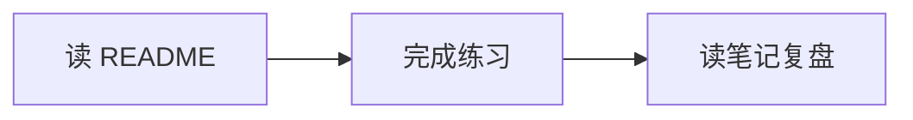

# 学习文档规范

本文适用于 `phaseN/dayNN/README.md`、`notes/phaseN/dayNN/*.md`，以及笔记链接的教学图表。目标读者是有 Java 后端经验、正在建立 Python 与 Agent 工程知识的学习者。

## 学习顺序

```text
README：学概念与关键机制
  → 练习：用代码验证并运用概念
  → 笔记：复盘练习结果，整理理解与误区
```

README、练习和笔记必须互相对应：README 教的概念能在练习中找到落点，练习的入口和验收在 README 中可查，笔记解释练习揭示的边界与原因。

## 文档分工

日 README 是练习前的知识导读。篇幅可以简洁，但必须包含完成当天练习所需的核心知识：

- 学习目标和必要前置概念。
- 核心术语、工作机制和重要边界。
- 能帮助建立心智模型的短例子或图解。
- 本日练习文件与概念的对应关系、运行命令和验收目标。

README 不是目录索引，也不是完整参考手册。不要把关键解释全部留给 AI 对话或练习后的笔记，也不要直接给出练习的完整答案。

笔记是练习后的复盘材料。它解释练习代码所用机制，整理运行时观察、遇到的误区、修正原因和仍需记住的边界。笔记不按当天发生顺序记流水账，不重复抄写 README；应从练习结果提炼可迁移的知识。

## 教学结构

根据主题选择合适结构，不为凑齐章节而填充内容：

1. 学习结果。说明读完后应能解释、判断或实现什么。
2. 问题背景。指出该概念解决的具体问题。
3. 核心模型。先讲定义和因果过程，再讲语法或 API。
4. 例子与图解。用短例子把运行过程具体化，并解释关键输出。
5. 边界与误区。说明结论何时成立、何时失效。
6. 练习衔接。给出代码入口、任务目标、运行命令与验收方式。
7. 复盘与主动回忆。笔记提出能从前文推导的问题，不在题目后立刻泄露答案。

从学习者熟悉的 Java 概念逐步引入 Python 概念。首次出现的术语就地解释，不假设读者熟悉运行时、类型检查器或异步调度器的内部细节。

## 图解

概念关系、调用顺序、状态转换、数据流适合使用 Mermaid。README 中的图用于建立当天整体结构，笔记中的图用于解释一个具体机制；避免在两处重复同一张图。



图中的每条边和状态转换都必须符合代码与协议行为。图注、节点标签和侧栏说明也要标清版本范围；不能用流程图掩盖并发顺序、异常或取消边界。

## 准确性

- 区分 Python 语言语义、CPython 实现细节、第三方库行为和本仓库约定。结论只适用于某个版本或实现时，明确范围。
- 不把类型注解、mypy 静态检查、Pydantic 运行时校验和 Python 运行时行为混为一谈。
- Java 类比不是一一等价。指出类比成立的范围和失效处，例如 `Protocol` 与接口、协程与线程、装饰器与注解。
- 对协议、服务商 API 和框架行为避免无依据的绝对判断。说明使用的版本、协议模式和具体行为。
- 对调度顺序、异常传播、取消、资源释放和并发副作用等高风险结论，给出执行过程或测试入口。
- 可运行示例提供必要导入与上下文；伪代码明确标为示意。示例应与当天实现一致。
- 实测观察不能推广成语言保证。实现相关的数字需注明环境和测量条件。

## 表达

- 一段围绕一个主要因果关系。先结论，后解释原因和例子。
- 删除重复结论、无关面试话术、未经验证的性能数字和只为显得完整而加入的章节。
- 表格只用于比较维度明确的概念，不代替必要解释。
- 中文文档和注释遵循 `zh-dev-writing` skill 与 `AGENTS.md` 中的项目约定。

## 验收

- README 单独阅读后，学习者能开始当天练习并理解任务目标。
- README 中的每个练习入口都能对应到一个已讲解的概念和明确的验收方式。
- 笔记记录的是练习后的理解与复盘，不是操作流水账或 README 的重复副本。
- 图解与正文、代码和测试表达一致，Obsidian/GitHub Markdown 中的 Mermaid 语法有效。
- 示例、链接、frontmatter 与站点构建均通过检查。

代码练习的粒度、组织和测试要求见 [CODE_PRACTICE.md](CODE_PRACTICE.md)。
