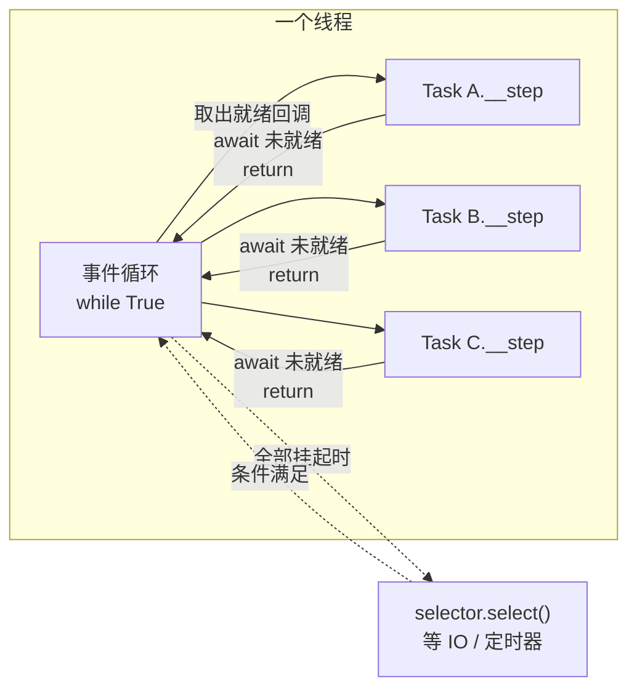
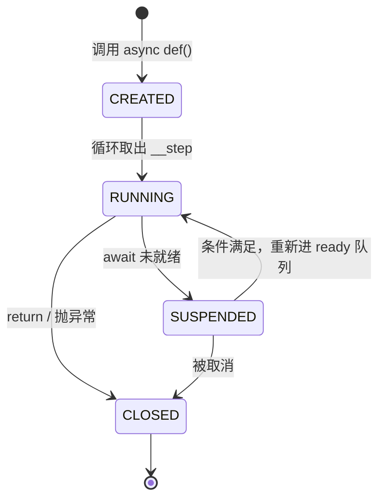
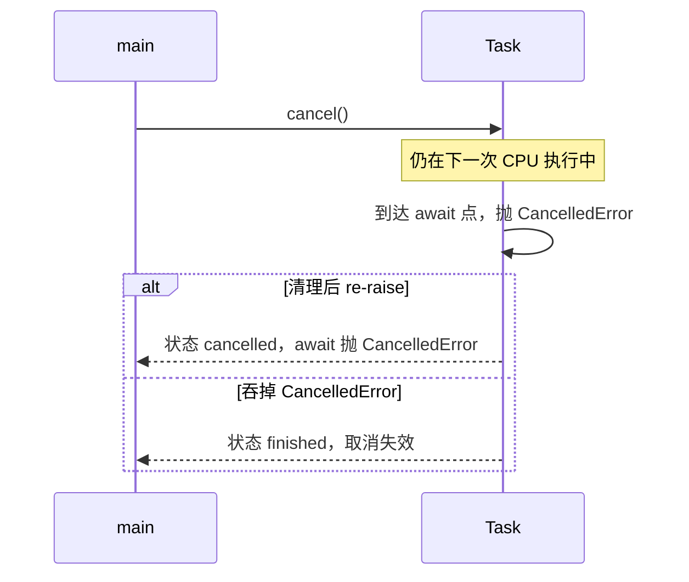
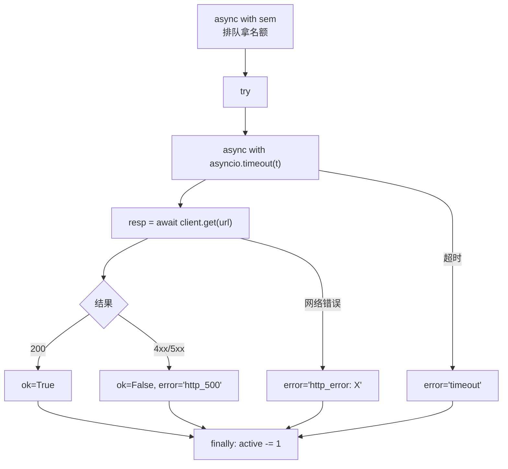

# Day 3 · asyncio 并发模型

> [!abstract] 产出
> `day03/python/` 五个脚本 · `day03/README.md`（知识树）· 本篇笔记

> [!tip] 三张可交互的图（本地 HTML，浏览器打开）
> [协程状态机](assets/coroutine-lifecycle.html) · [create_task 与 await 的唤醒链路](assets/await-wakeup.html) · [串行 await 与并发对比](assets/serial-vs-concurrent.html)

> [!tip] 一句话
> **单线程之所以能同时等很多事，是因为协程把栈帧存在堆上、自己 return 回事件循环。**
> 不是并行，是交替；不是自动，是手动 `await`。

---

## 全景



四个对象，各管一件事：

| 对象            | 是什么                      | Java 类比                |
| ------------- | ------------------------ | ---------------------- |
| **coroutine** | 可暂停的函数（`async def` 的返回值） | Kotlin 的 `suspend fun` |
| **Task**      | 协程 + 驱动壳，被循环调度           | `Future`               |
| **Future**    | 一个"尚未发生的结果"              | `CompletableFuture`    |
| **EventLoop** | 单线程调度器，维护就绪队列与定时器        | Netty 的 `EventLoop`    |

---

## 一、它解决什么问题

一次 LLM 调用，进程在做什么：

```text
发请求   1ms      CPU 干活
等推理   3000ms   纯等待，CPU 空转   ← 99.9% 在这
读响应   1ms      CPU 干活
```

**不是"算得慢"，是"等得久"。**

| 方案 | 代价 | 适合 |
|---|---|---|
| 多线程 | 每线程 1-8MB 栈、切换进内核、要加锁 | 同步库、连接数 ≤ 几百 |
| 事件循环 | 单线程、协程栈几 KB、切换是纯函数返回 | 高并发 IO、连接数上千 |

> [!warning] 不适用场景
> CPU 密集（矩阵、压缩、图像）用它没有收益——没有"等待"可以交出去。
> 那要的是**多进程**，各自有解释器，绕开 GIL。

---

## 二、为什么协程能被挂起（内存模型）

Java 线程不能挂起，Python 协程能，差别在**栈帧存在哪**。

```text
Java：帧在线程栈上（OS 分配的连续内存，512KB~1MB）
┌────────────┐
│ main 的帧   │
├────────────┤
│ f() 的帧    │  调用压入
├────────────┤
│ g() 的帧    │
└────────────┘
return = 弹栈 = 物理内存被覆盖，内容没了 → 没有"挂起"这种状态

Python：帧是堆上的普通对象
┌──────────────────────────────┐
│ frame 对象（实测 176 字节）    │
│   f_locals = {x: 21, ...}     │  局部变量
│   指令指针（跑到第几行）        │  恢复时靠它
└──────────────────────────────┘
        ↑ 谁持有引用？
   执行中       → C 栈临时引用
   已挂起       → coroutine 对象长期持有   ★
   普通 return  → 没人引用，立即回收
```

> [!important] 这就是"挂起"的物理实现
> **挂起 = 把帧从栈上摘下来、挂在协程对象上。**
> 它可以等 10 秒、10 分钟，占用 176 字节堆内存，而不是 512KB 线程栈。
> 这就是 asyncio 能挂起上万协程、线程只能开几百个的原因。

---

## 三、循环与用户代码的调用关系

两者不是并排运行，而是**调用关系**。在协程中打印调用栈（由内向外）：

```text
main()                        ← 用户协程，栈顶
  ↑
events.py: _run()             ← 循环执行一个就绪回调
  ↑
base_events.py: _run_once()   ← 循环的一次迭代
  ↑
base_events.py: run_forever() ← 真正的 while True
  ↑
runners.py: run()             ← asyncio.run()
```

> **协程 `await` 时 `return`，控制权沿栈退回 `_run_once`，此时是循环在执行。**
> 协程执行时循环停着，循环执行时协程停着：同一个线程，交替使用。

用监控任务实测（每行打印出来本身就证明 main 让出了）：

```text
0.029s  [monitor] main=SUSPENDED  ...
0.061s  [monitor] main=SUSPENDED  ...  f=DONE
0.061s  [main] *** 我被唤醒，拿到 'fast' ***
0.092s  [monitor] main=SUSPENDED  ...
```

---

## 四、状态机

| Java `Thread.State` | `inspect.getcoroutinestate()` | 触发 |
|---|---|---|
| `NEW` | `CORO_CREATED` | 调用 `async def` / `create_task` 排期后 |
| `RUNNABLE` | `CORO_RUNNING` | `Task.__step` 正在推它 |
| `WAITING`/`TIMED_WAITING`/`BLOCKED` | `CORO_SUSPENDED` | 卡在 `await` 上（不区分等多久） |
| `TERMINATED` | `CORO_CLOSED` | return / 异常 / 取消 |



> 带取消失效、Java 六态对照的可交互版本：[协程状态机](assets/coroutine-lifecycle.html)

**信息损失**：Java 用三个状态区分"等多久/等什么"，Python 只有一个 `SUSPENDED`。

---

## 五、`create_task` 只负责排队

```text
create_task(t)
  → 建 Task 对象
  → loop.call_soon(t.__step)     ← 只排队，t 还没跑
  → main 继续往下（不等）

main 遇到第一个真挂起的 await
  → main 让出
  → loop 取出 t.__step
  → t 第一次真正执行             ← 到这一刻才"开始"
```

实测：

```text
create_task 刚返回：state = CORO_CREATED, done = False
await sleep(0) 之后：state = CORO_SUSPENDED
```

反证——main 跑 0.2 秒无 `await` 的忙循环：

```text
0.201s  [main] 忙循环结束，此刻才第一次让出
0.201s  [main] 三个任务的 done: [False, False, False]   ← 一个都没跑
```

> [!danger] 硬规则
> **`create_task` 之后 main 不让出，任务永远不跑**——不是"稍后"，是永远。
> 这就是协程里写长时间同步循环会卡死整个服务的原因。

---

## 六、`await`：切换点

### 6.1 可能挂起，不是一定

```python
async def outer():
    print("即将 await")
    v = await no_suspend()     # 对方当场返回，一次 send(None) 穿过
    print("我还在同一次执行里")
```

```text
即将 await
我还在同一次执行里
send(None) 一次就抛了 StopIteration
```

**只有被 await 的对象尚未就绪时才真正让出。** 后果：`gather` 中若全部是纯计算协程，它们会串行执行完毕，不产生任何并发。

### 6.2 两种 `await`，行为完全不同

```python
await job("A1", 0.05)        # A：裸协程
await job("A2", 0.05)        # 总 0.111s，A2 在 A1 结束后才诞生

t1 = asyncio.create_task(job("B1", 0.05))
t2 = asyncio.create_task(job("B2", 0.05))
await t1; await t2           # 总 0.064s，两个同时在飞
```

| | `await coro()` | `await task` |
|---|---|---|
| 此刻在跑吗 | ❌ 还没诞生 | ✅ 已排期 |
| `await` 会驱动它吗 | ✅ 就地跑 | ❌ 只是等 |
| 调用栈 | **嵌套**（能看到 outer） | **独立** |
| `current_task()` | 与外层**同一个** | **不同** |
| 产生并发 | ❌ | ✅ |

实测：

```text
A: [outer] task id 1936682524416
   [A]     task id 1936682524416      ← 同一个
   [A]     栈: inner_coro <- outer_await_coroutine   ← 嵌套

B: [outer] task id 1936682524416
   [B]     task id 1936683483584      ← 不同
   [B]     栈: inner_coro             ← 独立
```

> 两条时间轴的并排对比：[串行 await 与 create_task 并发](assets/serial-vs-concurrent.html)

> [!important] 判据
> `await coro()` = "在这里跑完"（串行）；`create_task(coro)` + `await task` = "去跑，我回头取"（并发）。
> **差别不在 `await`，在有没有 `create_task`。**

### 6.3 唤醒顺序由被等的对象决定

```text
三个协程创建顺序 slow(A) → mid(B) → fast(C)
A await sleep(0.30)，B await sleep(0.10)，C await sleep(0.20)
唤醒顺序：B → C → A
```

**跟创建顺序、跟 ready 队列排位都无关。** 所以读 asyncio 代码，盯住每个 `await` 后面是什么，等于盯住了整个调度逻辑。

---

## 七、收集：多个任务怎么等

| 工具 | 结果顺序 | 一个失败 |
|---|---|---|
| `await f()` | — | 直接抛 |
| `create_task(f())` | 自己 await 取 | 挂在 Task 上，不主动抛 |
| `gather(*coros)` | **参数顺序** | 立刻抛（`return_exceptions=True` 则收集） |
| `TaskGroup()` | 自己管理 | **全体取消** + `ExceptionGroup` |
| `as_completed(tasks)` | **完成顺序** | 抛在迭代里 |

### 7.1 两个顺序，两个来源

| 顺序 | 谁产生 |
|---|---|
| **完成顺序** | 事件循环调度（定时器堆 + 就绪队列） |
| **交付顺序** | 组合器**是否重排** |

```text
gather        交付=['slow','fast','mid']   真实完成=['fast','mid','slow']
as_completed  交付=['fast','mid','slow']   真实完成=['fast','mid','slow']
[await t ...] 交付=['slow','fast','mid']   真实完成=['fast','mid','slow']
```

- **`gather` 在重排**：丢掉完成顺序，按参数下标摆回去——它违背了调度
- **`as_completed` 不编排**：谁先完成交谁，原样透传

### 7.2 `as_completed` 返回的不是 Task

CPython 3.11 文档第一句：*"Return an iterator whose values are coroutines"*。

```python
async def _wait_for_one():
    f = await done.get()      # 从完成信箱取；空就挂起
    return f.result()         # 直接给结果，不是 Task
```

所以必须两步，缺一不可：

```python
for x in asyncio.as_completed(tasks):
    result = await x          # 少了这个 await，拿到的只是协程对象
```

### 7.3 `for ... await` 为什么不是串行

```text
t=0.002  main  create_task x3，三个都没开始
t=0.002  main  进入 for，await 空队列 → main 挂起
t=0.002  loop  启动 slow / mid / fast
t=0.057  fast  完成 → 放入完成队列 → 唤醒 main
t=0.057  main  拿到 'fast' → 下一轮，信箱空 → 再挂起
t=0.148  mid   完成 → 同上
t=0.303  slow  完成 → 同上，结束
```

**串行的是 main 取结果的节奏，不是任务的执行。** 任务在 main 挂起的每个空档里自己往前跑。

> 完整往返（含 main 何时挂起、何时被唤醒）：[create_task 与 await 的唤醒链路](assets/await-wakeup.html)

### 7.4 选哪个

| 场景 | 选择 |
|---|---|
| 凑齐了才干活 | `gather` |
| 到了就处理（流式、进度条、多源竞速） | `as_completed` |
| 一败俱败 | `TaskGroup` |

---

## 八、约束：限流 / 超时 / 取消

### 8.1 Semaphore —— 并发上限

```python
sem = asyncio.Semaphore(3)
async with sem:            # 名额满了就在这排队
    ...
```

> [!danger] 计数必须在 `finally` 里还
> ```python
> async with sem:
>     tracker["active"] += 1
>     await asyncio.sleep(delay)     # 抛异常/被取消…
>     tracker["active"] -= 1         # …这行永远不执行
> ```
> Semaphore 自身不会泄漏（`async with` 保证 release），**泄漏的是自定义计数**。
> 实测：取消一个任务后残留 1。生产环境中该计数代表在途请求数，泄漏一次即为故障。

### 8.2 timeout —— 总时限

```python
async with asyncio.timeout(2.0):    # 3.11+
    resp = await client.get(url)
```

抛 `TimeoutError`，并**取消**里面正在跑的东西。`asyncio.wait_for(coro, 2.0)` 等价，但 `timeout` 能包住多步逻辑。

### 8.3 cancel —— 协作式取消



> [!danger] `CancelledError` 继承自 `BaseException`
> 不是 `Exception`，这是刻意的设计：防止 `except Exception` 顺手吞掉取消。
> 但若写成 `except BaseException:` 而不重抛，任务会"正常结束"，调用方以为已取消，实际仍在运行。

---

## 九、资源与流

| 同步 | 异步 |
|---|---|
| `__enter__` / `__exit__` | `__aenter__` / `__aexit__` |
| `with x:` | `async with x:` |
| `@contextmanager` | `@asynccontextmanager` |

`__aexit__` 返回 `True` 同样吞异常。**body 抛异常时 `__aexit__` 照样执行**：

```python
session = FakeSession()
try:
    async with session:
        raise ValueError          # __aexit__ 仍会跑
except ValueError:
    pass
assert session.events == ["open", "close"]
```

`async for` 的右边必须是**异步迭代器**（`async def` + `yield`，或有 `__aiter__`）：

```python
async for page in paginate(pages):   # ✓ 异步生成器
async for item in ["a", "b"]:        # ✗ TypeError: no __aiter__
```

`Queue` 用 `maxsize` 做背压，结束信号用 `None`（不要用 `queue.empty()`）：

```python
queue: asyncio.Queue[str | None] = asyncio.Queue(maxsize=2)
```

> [!warning] `maxsize` 不是「实际堆积过的最大长度」
> 它是配置的上限，恒等于 2。测量背压需要记录 `queue.qsize()` 的实际峰值。

---

## 十、实战：httpx 并发抓取



四条规则：

1. `Semaphore` 只包真正的工作，`timeout` 放它里面
2. **计时放 `timeout` 外面**，否则超时路径没有 `elapsed_ms`，格式化时 `TypeError`
3. 只抓 `TimeoutError` 和 `httpx.HTTPError`，绝不抓 `CancelledError`
4. `finally` 还名额

`fetch_all` 只做一件事：**建资源 + `gather(fetch_one(...))`**。

```python
sem = asyncio.Semaphore(max_concurrency)
tracker: dict[str, Any] = {"active": 0, "peak": 0}
async with httpx.AsyncClient(transport=transport) as client:
    return await asyncio.gather(
        *(fetch_one(client, url, sem, timeout, tracker) for url in urls)
    )
```

实测：

```text
offline: 5 个请求 / 并发上限 2 / 总耗时 0.35s   （串行下界 1.66s）
  [ok ] fast    200  36.8ms
  [ok ] mid     200  97.8ms
  [err] slow    None 310.8ms timeout
  [err] broken  500  15.6ms  http_500
  [ok ] normal  200  63.4ms
```

> [!tip] 为什么返回 dict 而不是抛异常
> 5 个里 1 个超时不该让整批失败。Agent 里"一个工具挂了"也是这个处理：回填错误给模型，继续跑。

---

## 十一、常见错误对照

| ❌ 错误 | ✅ 正确 | 后果 |
|---|---|---|
| `time.sleep()` | `await asyncio.sleep()` | 卡死整个循环 |
| 漏写 `await` | 补上 | 拿到 coroutine 对象，无警告 |
| `async for x in list` | `for x in list` | `TypeError: no __aiter__` |
| `Queue[str]` 写入 `None` | `Queue[str \| None]` | 类型错误 |
| 计数递减写在普通语句 | 放 `finally` | 取消/异常时泄漏 |
| `except Exception` 抓取消 | 不抓，让它传播 | 抓不到（`BaseException`） |
| `except BaseException` 吞取消 | 必须 re-raise | 取消失效 |
| `as_completed(...)` 直接返回 | for + `await` 逐个取 | 拿到生成器，没有结果 |
| `return queue.maxsize` 当峰值 | 记 `queue.qsize()` | 断言恒成立，等于没测 |
| 每个请求新建 `AsyncClient` | 一个 client 复用 | 连接池白建 |
| `async def` 里没有任何 `await` | 普通 `def` | 不产生任何并发 |

---

## 十二、Java → Python 对照

| Java | Python | 差异 |
|---|---|---|
| `new Thread(r)` | `create_task(coro)` | 都只是排期 |
| `t.start()` | **无对应物** | "启动"就是下一次循环迭代 |
| `t.join()` | `await task` | 让出而非阻塞线程 |
| `t.getState()` | `inspect.getcoroutinestate()` | 粒度更粗 |
| `Thread.sleep(ms)` | `await asyncio.sleep(s)` | 必须 await |
| `t.interrupt()` | `task.cancel()` | 都只是发请求 |
| `invokeAll()` | `gather` / `TaskGroup` | TaskGroup 才有"一败俱败" |
| `Semaphore` | `asyncio.Semaphore` | 几乎一致 |
| `CountDownLatch(1)` | `asyncio.Event` | |
| `ThreadLocal` | `contextvars.ContextVar` | |
| `CompletableFuture.allOf` | `gather` | |

> [!warning] Python 没有"协程池"
> 没有 worker 线程、没有任务排队等空闲 worker。`create_task` 之后任务全部"在飞"，
> 各自停在 `await` 上。Task = 协程 + 驱动壳，用完即弃。
> `as_completed` 内部的 `Queue` 是**完成事件信箱**，不是任务池。

---

## 十三、速查

```python
# 入口
asyncio.run(main())

# 造并发
t = asyncio.create_task(coro())        # 排期，不执行
await t                                 # 等结果
asyncio.gather(*coros)                  # 全部等，参数顺序
async with asyncio.TaskGroup() as tg:   # 一败俱败
    tg.create_task(coro())
for x in asyncio.as_completed(ts):      # 完成顺序
    await x

# 约束
async with asyncio.Semaphore(n): ...    # 并发上限
async with asyncio.timeout(s): ...      # 总时限
task.cancel()                           # 发取消请求

# 调试
inspect.getcoroutinestate(task.get_coro())
task.done() / task.cancelled() / task.result()
```

---

## 十四、自测

- [ ] 协程的帧存在哪里？为什么这决定了它能被挂起？
- [ ] 事件循环与协程是什么调用关系？画出调用栈
- [ ] `create_task` 返回时，协程状态是什么？
- [ ] main 一直不让出，任务会怎样？
- [ ] `await coro()` 和 `await task` 的三个差别
- [ ] `await` 一定挂起吗？什么情况不挂起？
- [ ] `gather` 和 `as_completed` 的结果顺序分别由谁决定？
- [ ] `as_completed` 产出的对象是什么？为什么必须再 `await`？
- [ ] `TaskGroup` 一个失败，兄弟会怎样？
- [ ] 为什么计数必须放 `finally`？
- [ ] `task.cancel()` 之后任务立刻停吗？
- [ ] `CancelledError` 继承自谁？为什么？
- [ ] `async for` 的右边可以是什么？
- [ ] `queue.maxsize` 能测背压吗？
- [ ] 唤醒顺序由什么决定？
- [ ] 一个没有任何 `await` 的 `async def` 有并发吗？

---

## 十五、明天

**Day 4 · pytest**：fixture vs JUnit `@BeforeEach`、参数化、mock、覆盖率
产出：给 Day 3 的代码写 5 个测试（3 成功路径 + 2 错误路径）

> [!note] 关联
> - `fetch_one` 把错误收敛成返回值，**这正是为测试准备的**——不抛异常才断言得动
> - `httpx.MockTransport` 今天已用上，Day 4 换成 pytest fixture
> - [[Day 1 · Java→Python 定向迁跃]] 的 GIL 和今天讲的是同一件事的两面
> - [[Day 2 · 函数是一等公民]]：生成器 → 协程是同一个机制
