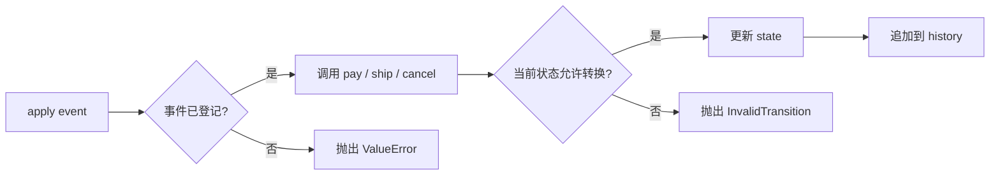

# Day 1 · Java 到 Python：先迁移模型，再记语法

## 学完后应能

- 解释可变默认参数为何会跨调用共享，以及如何安全初始化。
- 区分对象身份、值相等、真值判断和可空类型。
- 写出保留订单状态不变量的 Python 类，并说明类型注解不会替代运行时校验。

今天的可运行产出是 [批注版订单状态机](../../../phase1/day01/python/order.py)、[标准版](../../../phase1/day01/python/order_bean.py) 和 [Java 原版](../../../phase1/day01/java/Order.java)。先读 Java 行为，再比较 Python 实现，不要从语法逐行翻译。



图中的两类失败分别由事件分发表和状态转换校验产生，不能把“事件名有效”和“当前状态允许操作”合并成同一项检查。

## 1. 默认参数在定义函数时求值

Java 没有方法参数默认值。Python 有，但默认表达式在执行 `def` 时求值一次，并保存在函数对象上。

```python
def add(item: str, bucket: list[str] = []) -> list[str]:
    bucket.append(item)
    return bucket


print(add("a"))  # ['a']
print(add("b"))  # ['a', 'b']，仍是同一个默认列表
```

当默认对象可变时，多次调用会共享修改。使用 `None` 表示“本次未传入”，在函数体内创建新对象：

```python
def add(item: str, bucket: list[str] | None = None) -> list[str]:
    if bucket is None:
        bucket = []
    bucket.append(item)
    return bucket
```

`None` 既是实际值，也是这里约定的哨兵。不能用 `if not bucket` 代替身份检查，因为调用者传入的空列表也是合法输入。dataclass 字段使用 `field(default_factory=list)` 达到相同目的。

## 2. `==` 比值，`is` 比身份

| Python | 常见 Java 对应 | 含义 |
|---|---|---|
| `a == b` | `a.equals(b)` | 值是否相等，取决于类型实现的 `__eq__` |
| `a is b` | `a == b` | 是否为同一个对象 |

```python
a = [1, 2]
b = [1, 2]
assert a == b
assert a is not b
```

对象缓存、字符串驻留等优化不属于值比较规则。不要用 `is` 比较数字或字符串内容。比较 `None` 时写 `value is None`，因为 `None` 是单例对象。

## 3. 真值判断检查对象的真值规则

内置的 `None`、`False`、数值零和空容器为假；非空容器为真，不检查其中元素是否为真。

```python
bool([])       # False
bool([0])      # True
bool(" ")     # True
bool("0")     # True
```

Java 的 `if` 条件必须是 `boolean`，Python 则允许对象提供真值。用 `if items:` 表示“items 非空”很常见，但若业务需要区分 `None` 和空列表，应分别判断。

## 4. 实例字段、类字段与类型注解

类字段在类上创建并由实例查找；在类体给可变对象赋值会让实例共享同一个对象。实例字段通常在 `__init__` 中通过 `self` 创建。

```python
class Shared:
    tags = []


class PerInstance:
    def __init__(self) -> None:
        self.tags = []
```

`tags: list[str]` 只会登记注解，不会创建值为列表的属性。它与 `tags = []` 不同。类注解可在 `__annotations__` 中查看，第三方库也可以读取它。

## 5. 类型注解不等于运行时校验

```python
def greet(name: str) -> str:
    return "Hello " + name


greet(123)  # Python 运行时不会因为注解自动拒绝这个参数
```

类型注解主要供 IDE、mypy 等静态分析工具使用，也可能被运行时库读取。mypy 检查与 Pydantic 校验是不同机制。函数注解 `state: OrderState | None` 表示静态类型允许 `None`，不表示参数可以省略；参数是否可省略由默认值决定。

```python
def find_order(order_id: str | None) -> None:
    ...


find_order(None)  # 可以显式传 None
# find_order()   # 缺少必需参数，仍然是 TypeError
```

`@property` 是把受控读写行为暴露成属性语法。Day 1 的订单状态不提供 setter，外部只能调用 `pay`、`ship`、`cancel`，因此不能绕过状态转换检查。属性约定与可见性保护不同，Python 的 `_state` 仍能被外部访问，只是以下划线表示内部使用。

## 6. GIL、线程与 asyncio 是不同层的问题

本仓库使用带 GIL 的 CPython 3.11。GIL 约束同一解释器中线程执行 Python 字节码的并行性，不限制创建线程，也不阻止线程等待 I/O。某些阻塞 I/O 和原生扩展会在等待或计算时释放 GIL。

asyncio 通常由一个线程中的事件循环驱动多个 Task。Task 在等待网络、定时器等异步操作时让出控制权，循环转去运行其他 Task。这是并发等待，不是多个 Python Task 同时执行字节码。`await` 本身也不保证挂起，只有被等待的操作尚未就绪时才会让出。

Agent 服务常包含大量远端模型和数据库调用，所以异步 I/O 通常有帮助；本地 CPU 密集工作不会因为改写成 `async def` 自动加速。按任务性质选择线程、进程或原生并行实现。

## 7. 装饰器不是 Java 注解

装饰器表达式在执行 `def` 语句时运行。常见模块顶层函数是在模块导入时完成装饰，但这不是装饰器只能在导入时使用。

```python
@decorate
def work() -> None:
    ...

# 等价于
def work() -> None:
    ...


work = decorate(work)
```

装饰器可以返回原函数、包装后的函数或其他对象，因此会影响名称绑定和调用行为。Java 注解通常提供元数据，框架或编译器再读取这些元数据；Spring AOP 等框架可能通过代理改变调用路径，不能概括成“注解绝不改变行为”。装饰器的完整用法见 [[Day 2 · 函数是一等公民]]。

## 8. 导入、依赖与算术差异

- `import` 由 `sys.path` 中的搜索位置解析。虚拟环境隔离第三方包，`uv run` 选择项目环境；它们不是 Java classpath 的逐项对应物。
- `pyproject.toml` 声明项目与依赖，`uv.lock` 锁定解析结果。`uv sync` 同步环境，`uv run` 在项目环境中执行命令。
- 对整数操作数，Python 的 `/` 返回浮点商。`//` 向负无穷取整，余数与除数同号；Java 整数除法向零截断，余数与被除数同号。

```python
7 / 2    # 3.5
-7 // 2  # -4
-7 % 3   # 2
```

Python 用缩进表示代码块，混用 tab 和空格可能产生 `TabError`。本仓库使用四个空格，由 Ruff 格式检查验证。

## 9. 相等、哈希与 dataclass

普通 Python 类没有自定义 `__eq__` 时，`==` 默认按对象身份比较，和 Java 未重写 `equals` 时相似。`order_bean.py` 选择让同 ID 订单相等，这是额外的领域建模决定，Java 原版没有这项行为。

若自定义 `__eq__`，Python 默认会将 `__hash__` 设为 `None`，使对象不可作为 `set` 元素或 `dict` 键。若对象可哈希，必须满足 `a == b` 蕴含 `hash(a) == hash(b)`；哈希相同不保证对象相等。实体是否按 ID 相等，应由领域语义决定。

`@dataclass` 默认生成 `__repr__` 和 `__eq__`，通常生成 `__init__`。手写 `__init__` 时它不会再生成初始化方法，但仍可能生成其他方法。默认 `eq=True, frozen=False` 时对象不可哈希。是否使用 dataclass 取决于对象的语义与约束，不必为了使用它而把所有初始化逻辑搬进 `__post_init__`。

订单状态机需要保护转换规则，保留显式业务方法更容易看出允许的状态变化。对照 Java 原版检查：`PAID` 可以取消，`SHIPPED` 与 `CANCELLED` 不可以取消。

## 自测

- 默认列表何时创建？调用者传入空列表时，为什么不能用 `if not bucket` 判断是否使用默认值？
- 两个内容相同的列表满足 `==` 吗？满足 `is` 吗？
- `tags: list[str]` 和 `tags = []` 在类体中分别创建什么？
- 注解能否阻止错误类型的调用？`x: T | None` 是否意味着参数可省略？
- asyncio 的并发来自哪里？它是否让多个 Task 同时执行 Python 字节码？
- 为什么订单状态不暴露 setter？如果外部直接写 `_state`，Python 会阻止吗？

## 下一步

Day 2 会把函数当作值传递和替换，并用 Pydantic 生成工具参数 schema。可变默认参数与注解边界会再次出现。
