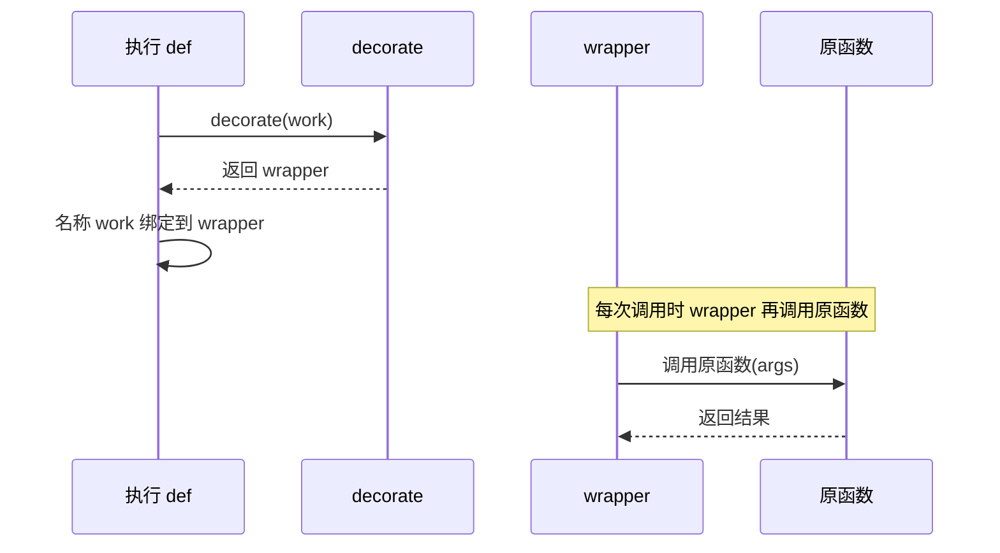
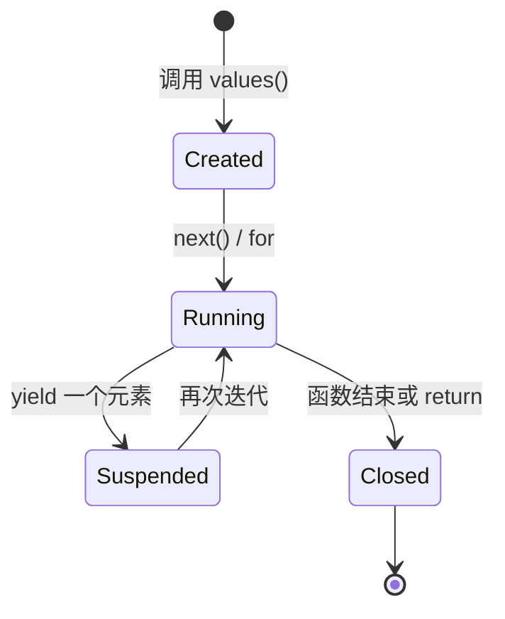
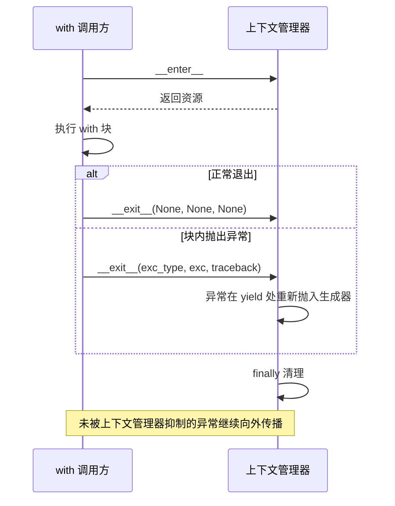

# Day 2 · 函数、迭代与类型边界

## 学完后应能

- 追踪装饰器在定义和调用两个时刻分别做了什么。
- 解释生成器何时执行、如何暂停，以及上下文管理器如何保证清理。
- 区分类型注解、静态检查、运行时校验，并读懂本仓库的 Pydantic 工具 schema 转换。

当天代码分为四个练习和一个主产出：[装饰器](../../../phase1/day02/python/decorators.py)、[生成器](../../../phase1/day02/python/generators.py)、[上下文管理器](../../../phase1/day02/python/context.py)、[typing](../../../phase1/day02/python/typing_practice.py)、[工具 schema](../../../phase1/day02/python/tool_schema.py)。图示：[装饰器时序](assets/decorator-timing.html)、[`with` 执行过程](assets/contextmanager-with.html)。

## 1. 装饰器在定义函数时替换名称

```python
from functools import wraps


def decorate(function):
    @wraps(function)
    def wrapper(*args, **kwargs):
        return function(*args, **kwargs)

    return wrapper


@decorate
def work() -> str:
    return "done"

# 等价于
def work() -> str:
    return "done"


work = decorate(work)
```



执行 `def` 语句时，Python 创建函数对象并调用装饰器表达式，函数名称随后绑定到装饰器返回的对象。模块顶层定义通常发生在导入期间；在函数内部定义时，装饰器会在该 `def` 语句执行时运行。

调用次数与装饰器工厂运行次数不同：`@timer` 装饰一个函数时，`timer` 执行一次；返回的 `wrapper` 会在每次调用时执行。带参数的 `@retry(3)` 多一层配置函数，因为配置先于被装饰函数传入。

`functools.wraps` 将被包装函数的常用元数据设置到 wrapper，并设置 `__wrapped__`。它不会让 wrapper 的代码签名自动变成原函数的 Python 参数列表；`inspect.signature` 等工具可沿 `__wrapped__` 读取原签名。

注册型装饰器如果只负责把函数登记到工具表，通常应返回原函数。否则模块中的函数名和注册表中的对象可能不同，调用路径也会不同。

## 2. 生成器把执行状态保存在迭代器中

调用含有 `yield` 的函数会创建生成器对象，函数体尚未运行。`next()`、`for`、`list()` 等迭代操作才会推进它。

```python
from collections.abc import Iterator


def values() -> Iterator[int]:
    print("开始")
    yield 1
    print("继续")
    yield 2


items = values()  # 尚未打印
print(next(items))  # 打印“开始”，然后得到 1
```



生成器是一次性迭代器。推进到 `yield` 后会暂停，之后从下一条语句恢复。`Iterator[str]` 中的 `str` 描述迭代产出的元素类型。

生成器中的 `return value` 结束迭代。`for` 和 `list()` 只观察到迭代结束，不会把该值当成元素；手动调用 `next()` 并捕获 `StopIteration` 时，可以读取 `exc.value`。

本仓库的 `iter_chunks` 定义 `size` 为最大块长度，`overlap` 为相邻块重叠的字符数。对于 `"abcdefg"`、`size=3`、`overlap=1`，结果是 `abc`、`cde`、`efg`。最后一块覆盖文本末尾后就应停止，不能再从重叠区域产生重复尾块。由于它是生成器，参数检查也在第一次迭代时执行，而不是调用函数时执行。

## 3. 上下文管理器让进入与清理配对

`with manager as value` 使用的是上下文管理器协议。同步协议调用 `__enter__` 和 `__exit__`；即使 `with` 块抛出异常，`__exit__` 仍会运行。只有 `__exit__` 返回真值时，异常才会被抑制。

```python
with open("data.txt", encoding="utf-8") as file:
    text = file.read()
```

`contextlib.contextmanager` 是标准库装饰器，不是语言语法。它把生成器函数转换成上下文管理器工厂：`yield` 之前的代码在进入时执行，之后的代码在退出时执行。

```python
import time

from collections.abc import Iterator
from contextlib import contextmanager


@contextmanager
def timed() -> Iterator[None]:
    start = time.perf_counter()
    try:
        yield
    finally:
        print(time.perf_counter() - start)
```



块内异常会在 `yield` 位置重新抛进生成器。因此 `finally` 能在正常退出、异常和取消等控制流下执行清理。若要有意抑制某类异常，应显式捕获并处理，不要依赖含糊的返回值。

本仓库的 `Suppress` 类检查异常类型的继承关系，所以使用 `issubclass(exc_type, self.exc_types)`。这与 `except ValueError` 能处理其子类的行为一致。

## 4. 注解、静态检查与运行时校验

Python 不会因为函数注解而自动拒绝错误实参。注解仍可能保存在 `__annotations__` 中，供 IDE、mypy、框架或运行时库读取。

| 机制 | 何时工作 | 本仓库示例 |
|---|---|---|
| 类型注解 | 声明意图，可在运行时读取 | `str`、`T \| None` |
| 静态检查 | 运行 mypy 时分析代码 | `Protocol`、`Generic[T]` |
| 运行时校验 | 程序执行到校验逻辑时检查数据 | Pydantic `BaseModel` |

`x: int | None` 允许显式传 `None`，不表示参数可以省略；能否省略由是否提供默认值决定。`Any` 会弱化静态检查，不是与 Java `Object` 完全等价的根类型。

`Protocol` 描述对象需要具备的接口形状。mypy 可以对静态类型进行结构化检查，不要求类显式继承该 Protocol。Python 运行时不会自动执行 mypy 检查；若要做有限的运行时结构检查，需要额外使用 `@runtime_checkable`，且它的检查范围有限。

`Generic[T]` 让类型检查器在类和函数之间传递类型信息。它不等于 Java 编译器对泛型调用的静态约束，Python 运行时也不会普遍根据 `T` 拒绝不匹配的值。

## 5. Pydantic schema 转换的范围

Pydantic `BaseModel` 将字段声明用于运行时数据校验，也可以通过 `model_json_schema()` 生成 JSON Schema。它不是只有类型注解：Pydantic 会读取字段、默认值与 `Field` 约束，并在模型校验时执行对应规则。

当天的 `OrderQueryArgs` 与 `TicketCreateArgs` 只有基础字段和 `Literal`，当前 Pydantic 输出不含 `$ref`。`tool_schema.py` 仍实现了教学用的引用展开，并用一个合成的嵌套 schema 验证：查找 `$defs` 中的简单本地引用，递归替换定义，再移除本项目选择过滤的键。该函数不是完整的 JSON Pointer 解析器。递归路径用于检测循环引用，缺少目标定义时抛出错误。

```mermaid
flowchart LR
    model[Pydantic BaseModel] --> schema[model_json_schema()]
    schema --> refs{含本地 $ref?}
    refs -- 否 --> tool[组装 function.parameters]
    refs -- 是 --> defs[查找 $defs 定义]
    defs --> expand[递归展开引用]
    expand --> clean[移除本项目选择过滤的键]
    clean --> tool
```

这段转换展示“引用如何指向定义”和“递归遍历如何工作”。是否需要展开 `$ref`、哪些 schema 关键字可用，取决于目标 API 的协议版本与模式；不要把本练习的转换策略推广成所有模型服务的要求。调用真实 API 前，应以目标服务的 schema 文档和响应验证兼容性。

## 自测

- 装饰器工厂、decorator 和 wrapper 分别何时运行？
- `functools.wraps` 处理了什么？哪些运行行为不会因此自动变化？
- 调用生成器函数后，函数体是否已执行？谁负责推进它？
- 生成器的 `return value` 是否会成为 `for` 循环中的最后一个元素？
- `__exit__` 返回真值代表什么？`contextmanager` 中的异常会在哪里出现？
- 类型注解、mypy 和 Pydantic 分别在哪个阶段产生作用？
- `Protocol` 是否会在普通函数调用时自动检查对象？
- 本仓库为什么展开 `$ref`？这是否意味着所有服务都要求展开？

## 下一步

Day 3 将使用 `asyncio` 组织多个 I/O 等待。生成器的“暂停后恢复”有助于理解协程，但生成器和协程的协议、调度方式并不相同。
