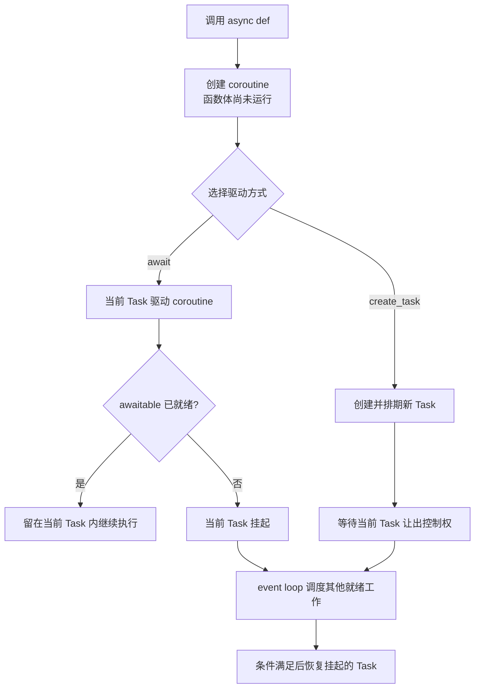

# Day 3 · asyncio：Task 如何共享一个事件循环

## 学完后应能

- 从一次 I/O 等待解释事件循环为何可以推进其他 Task。
- 判断代码创建的是 coroutine 还是 Task，以及控制权何时可能切换。
- 根据结果顺序、失败处理和资源约束选择 `gather`、`TaskGroup`、Semaphore 与 timeout。

当天代码从 [状态跟踪](../../../phase1/day03/python/00_trace.py) 开始，依次阅读 coroutine、Task、控制与资源，再运行 [httpx 并发抓取](../../../phase1/day03/python/05_fetch.py)。三幅交互图：[coroutine 生命周期](assets/coroutine-lifecycle.html)、[Task 唤醒过程](assets/await-wakeup.html)、[串行与并发等待](assets/serial-vs-concurrent.html)。

## 1. 先从等待理解并发

HTTP 请求通常花少量时间发送和解析数据，却可能等待远端数百毫秒。串行等待时，等待期间当前线程没有可执行的业务代码。asyncio 允许当前 Task 在等待异步 I/O 时暂停，让同一事件循环线程推进其他已就绪 Task。

这里的“并发”是多个操作的等待时间可以重叠，不是同一线程同时执行多段 Python 字节码。CPU 密集计算没有可让出的 I/O 等待，放进普通 asyncio Task 不会因此变快。

## 2. coroutine、Task 与事件循环

```python
import asyncio


async def fetch() -> str:
    await asyncio.sleep(0.1)
    return "ok"


coro = fetch()                       # 创建 coroutine，函数体尚未执行
task = asyncio.create_task(fetch())  # 创建并排期 Task
```



coroutine 对象保存异步函数可恢复的执行状态。Task 是事件循环驱动 coroutine 的调度单元。`create_task` 不会在调用位置内联执行 coroutine；当前代码继续运行，等当前 Task 让出控制权后，事件循环才执行新 Task。

这不等于“协程没有身份”或“Java 线程不能暂停”。coroutine 是真实对象，也可以暂停和恢复；它与 OS 线程的栈和调度方式不同。实现细节随 Python 实现和版本变化，不应把某次运行测得的帧大小写成语言保证。

## 3. `await` 可能让出，也可能直接返回

`await x` 等待 `x` 完成。若 `x` 已就绪，当前 Task 可以继续执行而不把控制权交回事件循环；若 `x` 还未就绪，当前 Task 挂起，循环可以运行其他 Task。

- `await child()` 不创建新 Task。child 在当前 Task 的执行链中运行；child 遇到真正的异步等待时，当前 Task 也会挂起。
- `task = asyncio.create_task(child()); await task` 会等待另一个 Task。该 Task 有独立的调度生命周期。
- 漏写 `await` 会得到 coroutine 对象。它不会因此自动排期；未等待的 coroutine 还可能在程序结束时触发运行时警告。

所以 `await` 不是“线程切换”指令。真正的控制权切换取决于被等待对象是否需要等待，以及它如何实现等待协议。

## 4. 多个操作的调度和收集

```python
results = await asyncio.gather(fetch_a(), fetch_b())
```

`gather` 会将传入的 coroutine 安排为 Task，并等待所有结果。返回列表按参数顺序排列，即使实际完成顺序不同。

默认异常行为需要单独记住：某个 awaitable 抛出异常时，`gather` 会把异常传播给等待它的调用方；其他 awaitable 不会仅因为这个异常而自动取消。传入 `return_exceptions=True` 时，异常会作为对应位置的结果返回。

Python 3.11 的 `TaskGroup` 用词法作用域管理子任务。某个子任务抛出非取消异常时，TaskGroup 会请求取消仍在运行的兄弟任务，等待它们完成清理，再以异常组传播失败。单个任务被取消本身不等同于普通异常失败。

`as_completed` 适合“先完成先处理”。Python 3.11 中它是普通迭代器，迭代得到 awaitable 后还要 `await`：

```python
for completed in asyncio.as_completed(tasks):
    result = await completed
    handle(result)
```

Python 3.13 起它还支持异步迭代。读文档或调试时要按运行版本判断迭代接口。

| 工具 | 结果处理 | 失败语义 |
|---|---|---|
| `gather` | 全部完成后按输入顺序返回 | 默认传播首个异常，不自动取消其他任务 |
| `TaskGroup` | 结果需由任务自行保存 | 子任务非取消异常会取消仍运行的兄弟 |
| `as_completed` | 按完成先后逐个处理 | 异常在 await 对应结果时传播 |

## 5. 限流、超时与取消

Semaphore 控制同时进入某段代码的 Task 数。通常把它放在单个请求的工作边界上：

```python
import asyncio
import httpx


semaphore = asyncio.Semaphore(3)

async def bounded_request(client: httpx.AsyncClient, url: str) -> httpx.Response:
    async with semaphore:
        return await client.get(url)
```

`async with` 在退出时释放名额，包括异常退出和取消。若另有自定义活动计数器，其减计数也应放入 `finally`，因为 Semaphore 不会替应用维护这些变量。

Python 3.11 的 `asyncio.timeout(seconds)` 限制上下文内的总时长。超时会取消当前 Task；上下文管理器在边界处把自己的取消转换为 `TimeoutError`。不要在超时上下文内捕获并吞掉 `CancelledError`，否则取消语义会被破坏。

`task.cancel()` 是取消请求，不是立即强制终止。协程在可取消的等待点收到 `CancelledError`。需要清理的资源放在 `finally` 或异步上下文管理器中，完成清理后通常让取消继续向上传播。

## 6. 异步资源与流

- 同步资源实现 `__enter__` / `__exit__`，异步资源实现 `__aenter__` / `__aexit__`，分别由 `with` 和 `async with` 使用。
- 异步迭代器实现 `__aiter__` / `__anext__`；异步生成器是常见实现。普通 list 不能直接用于 `async for`。
- 有界 `asyncio.Queue` 在队列达到 `maxsize` 时让 `put()` 等待，可形成生产者背压。`maxsize` 是配置上限，不是运行期间测得的峰值。

资源应尽量在一个清晰的生命周期内创建和关闭。不要为每个请求新建一个 httpx client，否则连接池无法在请求间复用。

## 7. 把规则映射到 `05_fetch.py`

抓取脚本为每个 URL 创建一个异步操作，并共享一个 `httpx.AsyncClient`。Semaphore 限制同时请求数，timeout 限制单次操作耗时，`gather` 收齐结果并保留 URL 输入顺序。每个 URL 的网络失败被转换为结果对象，因此单个请求失败不会让整批结果丢失。

检查实现时依次回答：

1. client 在哪里创建，又在哪里关闭？
2. Semaphore 覆盖了哪些操作？名额何时释放？
3. timeout 覆盖等待 client 响应的哪一段？
4. 超时、HTTP 状态错误、连接错误分别转成什么结果？
5. 为什么返回顺序仍与 URL 输入顺序一致？

计时与活动计数是脚本的观测数据，不是 asyncio 自带的指标。计数的配对修改应放在 `try/finally`，这样取消路径也会归还计数。

## Java 对照的适用边界

`await task` 可粗略类比等待 Future 完成；`create_task` 可类比提交异步工作。但 Task 通常由单线程事件循环协作调度，不等同于 Java `Thread` 或线程池中的工作线程。取消也都是需要调用方理解其传播语义的控制请求，不能假设调用 `cancel()` 就会立即停止。

## 自测

- 调用 `async def` 返回什么？`create_task` 又新增了什么？
- `await` 在什么情况下不会造成切换？
- `gather` 的结果顺序由什么决定？一个任务失败后兄弟任务会自动取消吗？
- TaskGroup 与 gather 在异常传播和兄弟任务清理上有何不同？
- Python 3.11 的 `as_completed` 迭代结果为什么还要再次 `await`？
- 取消发生时，Semaphore 名额、活动计数和 client 应如何清理？
- `05_fetch.py` 中哪一处保证结果按输入 URL 顺序返回？

## 下一步

Day 4 会用 pytest 验证 `05_fetch.py` 的成功、超时和连接错误路径。测试会使用 httpx 的 mock transport，避免依赖公共网络。
