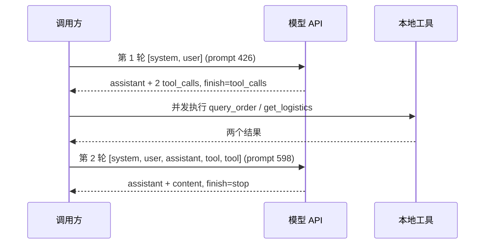

# Day 6 · function calling 会话实测

## 学完后应能

- 说出一次工具调用会话里每条消息的来源与去向：哪些由调用方构造，哪些由模型返回。
- 解释 `finish_reason` 为什么比"有没有 tool_calls 字段"更可靠，以及 length / content_filter 两种非正常结束的处理差异。
- 指出 `arguments` 解析、工具执行、回填配对三个环节各自的失败方式与处理边界。
- 从日志的 token 数读出历史全量重发的成本曲线。

主产出是 [tool_call_session.py](../../../phase2/day06/tool_call_session.py)。协议形状练习见 [protocol.py](../../../phase2/day06/protocol.py) 与 [roundtrip.py](../../../phase2/day06/roundtrip.py)。本文引用的数据全部来自真机会话日志 [session-20261122-154748-371904.json](../../../phase2/day06/logs/session-20261122-154748-371904.json)（模型 `deepseek-v4.1-flash`，两轮请求，总耗时 11.5 秒），JSON 片段为日志原文。该日志是仓库中保留的唯一会话日志示例，后续日志不入库；引用的 token 数与消息形状以它为准，重新生成的日志数字会因模型与提示词变化而不同。

## 1. 会话时序：六条消息，两轮请求



第 2 轮 prompt 比 第 1 轮多 172 tokens，恰好是上一轮的 assistant 请求加两条 tool 回填。这个数字直接验证了历史的全量重发：模型没有跨请求记忆，调用方提交的 messages 就是它的全部上下文。多轮会话的成本随轮数增长——每轮的 prompt 都包含此前全部内容，不是增量发送。

日志里保存的是每轮完整的请求体与响应体（`exchanges` 字段）。协议错误大多不在发出时报，而是在下一轮请求被 400 拒绝时才暴露；定位这类问题要靠上一轮的请求原文，这就是逐轮落盘的原因。

## 2. 每轮请求体长什么样

请求体的顶层字段固定五个，两轮请求完全一致，变的只有 `messages`：

```json
{
  "model": "...",
  "messages": [ ... ],
  "tools": [ 两个工具定义，见 2.1 ],
  "tool_choice": "auto",
  "parallel_tool_calls": true,
  "max_tokens": 512
}
```

`tools`、`tool_choice`、`parallel_tool_calls`、`max_tokens` 每轮都原样重发。真正逐轮增长的是 `messages`，下面按轮拆开。

### 第 1 轮：会话开始

```text
messages = [
  {"role": "system", "content": "你是电商售后助手。……"},
  {"role": "user",   "content": "A1001 发货了吗？发的什么快递？"}
]
```

只有 system 和 user。此时没有任何工具相关消息。

### 第 2 轮：执行完工具之后

```text
messages = [
  {"role": "system",   "content": "你是电商售后助手。……"},        ← 原样保留
  {"role": "user",     "content": "A1001 发货了吗？……"},          ← 原样保留
  {"role": "assistant", "content": null,                          ← 模型的原话，原样放回
   "tool_calls": [
     {"id": "call_1", "type": "function", "function": {"name": "query_order",
      "arguments": "{\"order_id\": \"A1001\"}"}},
     {"id": "call_2", "type": "function", "function": {"name": "get_logistics",
      "arguments": "{\"order_id\": \"A1001\"}"}}
   ]},
  {"role": "tool", "tool_call_id": "call_1",                       ← 程序新造
   "content": "{\"ok\": true, \"data\": {\"order_id\": \"A1001\", \"status\": \"已发货\"}}"},
  {"role": "tool", "tool_call_id": "call_2",                       ← 程序新造
   "content": "{\"ok\": true, \"data\": {\"order_id\": \"A1001\", \"carrier\": \"顺丰\", \"tracking\": \"SF1234567890\"}}"}
]
```

回答"带不带模型发过来的 tool_calls"：**带，且必须原样放回**。第 2 轮 messages 的第 3 条就是模型上一轮返回的 assistant 消息本身——`id`、`arguments` 一字不改。这不是程序"转述"给模型，而是对话记录的一部分：模型看到的是"我上一轮请求了这两个调用"，后面紧跟两条结果。改写或省略这段，消息序列就不合法，多数 provider 以 400 拒绝。

六条消息里只有两条是程序**新造**的（两条 role=tool），其余四条要么是初始构造（system、user），要么是模型返回后原样 append（assistant）。这就是"模型提出请求、程序执行工具、历史完整保留"三件事在 messages 里的体现。

消息的角色顺序也是协议约束：tool 消息必须紧跟在带 tool_calls 的 assistant 之后，中间不能插入其他角色；两条 tool 之间的先后不影响配对（按 id 对应），但都不能缺席。

## 3. 每条消息的字段与边界

### tools 定义：模型读的是 description

```json
{
  "type": "function",
  "function": {
    "name": "query_order",
    "description": "按订单号查询订单状态。",
    "parameters": {
      "type": "object",
      "properties": {
        "order_id": {"description": "订单号，例如 A1001", "type": "string"}
      },
      "required": ["order_id"]
    }
  }
}
```

模型选择工具、填写参数，依据是 `description` 与每个属性的 `description`。`parameters` 由 Pydantic 模型的 `model_json_schema()` 生成，`title` 键在生成时删除。这些键的取舍属于本项目约定：OpenAI 协议文档对 `title` 的处理没有明确承诺，实测 DeepSeek 接受不带 `title` 的 schema。

### assistant 的 tool_calls：模型的请求

```json
{
  "role": "assistant",
  "content": null,
  "tool_calls": [
    {
      "id": "call_e2e8a94967f84130a486767e",
      "type": "function",
      "function": {
        "name": "query_order",
        "arguments": "{\"order_id\": \"A1001\"}"
      }
    }
  ]
}
```

三个从日志确认的细节：

- `arguments` 是 JSON 字符串。模型逐 token 生成这段文本，语法错误的概率不可忽略，解析失败要作为可恢复错误回填，而不是让请求失败。
- 两个调用各自带独立 `id`，回填时按 id 配对。id 是 provider 生成的不透明字符串（此处为 `call_` 前缀加十六进制），程序不能假设格式。
- 要求调用工具时 `content` 为 null。`content` 与 `tool_calls` 的并存约束各 provider 不同，本项目的判断依据是 `finish_reason`，不依赖 content 是否为空。

日志里还有一处 provider 扩展：响应包含 `reasoning_content` 字段（思维链），主产出原样存入 messages，第 2 轮请求又原样发回。该字段不在本仓库使用的协议子集内，其他 provider 可能拒绝含此字段的请求。遇到兼容性问题时，先检查是否在发送前剥离了 provider 专属字段。

### tool 回填：程序的回答

```json
{
  "role": "tool",
  "tool_call_id": "call_e2e8a94967f84130a486767e",
  "content": "{\"ok\": true, \"data\": {\"order_id\": \"A1001\", \"status\": \"已发货\"}}"
}
```

`content` 是字符串（JSON 序列化后），不是对象——协议对 content 的类型要求是 string，直接放 dict 会在下一轮请求序列化或 provider 校验时失败。本项目用 `{"ok": bool, "data"|"error"}` 一个形状同时表达成功与失败：回填消息的传输层永远是成功状态，模型区分对错靠的是 content 内部结构。

### usage：token 分布

```text
第 1 轮: prompt 426 + completion 93  = 519（含 reasoning_tokens 20）
第 2 轮: prompt 598 + completion 26  = 624
```

第 1 轮的 completion 中，20 tokens 是思维链、其余是工具调用 JSON。`max_tokens` 限制的是 completion 总量，思维链计入在内。对返回思维链的模型，`max_tokens` 过小会在思维链阶段触发 `finish_reason=length`，响应里没有任何工具调用，循环按截断终止。这是日志实测的数字，不同模型与提示词下分布会不同。

## 4. 循环：每一步做什么，处理不好会怎样

`run_session` 每轮的顺序固定：发送完整 messages → 按 `finish_reason` 分派 → 解析参数 → 执行工具 → 回填。这一节按这五步走一遍，每步先说职责，再说处理不好时的具体后果。

### 4.1 分派：finish_reason 决定走向

`finish_reason` 比检查 tool_calls 字段可靠，因为字段缺失不能区分"正常结束"与"被截断"：

| finish_reason | 动作 | 处理不好会怎样 |
|---|---|---|
| `tool_calls` | 继续循环 | — |
| `stop` | 返回答案，结束 | — |
| `length` | 报错终止 | 当作答案返回：用户拿到一段被切断、语义不完整的内容，且程序不报错 |
| `content_filter` | 报错终止 | 当作答案返回：被拦截的内容以正常回答的样子交到用户手里 |

用"有没有 tool_calls 字段"分派的实现，在这两种非正常结束上必然出错：截断的响应通常没有 tool_calls，循环会把它当最终答案返回。未知取值抛 `ValueError` 而不是当作 stop——provider 扩展新取值时，把未知状态当正常结束会静默丢失后续轮次。兼容 [OI] 的服务可能有本表之外的结束原因，取值以所用服务文档为准。

终止条件有两个：`finish_reason=stop`，以及轮数达到 `max_turns`（当前为 3）。没有轮数上限时，模型反复请求同一工具会让循环持续消耗 token 与配额，且调用方看不到任何进展。轮数耗尽时抛异常而不是返回部分结果——调用方需要知道会话没有正常结束。

### 4.2 解析：模型输出不可信

```python
raw_arguments = json.loads(function["arguments"])
arguments = args_model.model_validate(raw_arguments)
```

两层校验各拦一类错误：`json.loads` 拦非法 JSON（模型逐 token 生成这段文本，语法错误是正常输出而非异常）；`model_validate` 拦形状错误——JSON 合法但缺字段、类型不对，模型可能输出 `{"order_id": 1001}`（数字）。

两层的失败都必须转成错误回填，异常不能逃出 `invoke_tool`。处理不好的后果按抛与不抛分两种：异常逃出去，整个会话终止，模型连修正的机会都没有；不校验直接展开 dict，`fn(**arguments)` 会把 `order_id=1001` 原样传进工具——Python 不看类型注解，展开不报错，错误的类型进了工具内部，最终抛出的是某个远端的、难定位的失败，而不是"参数类型错"。用 Pydantic 校验的另一个理由是错误信息可读：`validation error for QueryOrderArgs.order_id, input 1001` 进入下一轮上下文，模型能看懂并修正。

### 4.3 执行：工具失败也是信息

工具内部的异常（如订单不存在）统一转成错误回填；未登记的工具名同样回填"未知工具"而不是抛异常。两类失败的共同点是：它们都是模型可以据此调整下一步的信息——收到"订单不存在"后模型会向用户确认订单号，收到"未知工具"后模型会换表内的工具。抛异常的后果是会话终止，而模型本有能力走完。

边界只有一个例外：`asyncio.CancelledError` 不捕获。它继承 `BaseException`，属于外层的取消机制；`except Exception` 恰好不会碰到它，但 `except BaseException` 会吞掉它——取消信号消失，任务看起来正常结束，调用方的超时与取消全部失效。

### 4.4 回填：程序自己的 bug 在这里暴露

`validate_roundtrip` 在回填后立即检查 id 配对、role 与重复项。前三步处理的是模型输出不可信的问题，这一步针对的是调用方自身的 bug：漏 append 一条 tool 消息、从 tool_call 里取错了键（`call_id` 与 `id` 两个键名）、把回填消息的 role 写错。这类错误在本地显式失败，代价是一次可定位的断言；不校验的代价是留到下一轮 400 才暴露——那时报错的是远端服务，错误信息只说消息序列不合法，不说是哪条、缺哪条。离线模式全绿说明程序侧协议实现正确，真机验证剩下的部分是 provider 行为兼容。

传输层的 401/403 与 429 不在这五步内，属于请求发出之前的问题。当前实现不对任何状态码重试，阶段 5 的服务层再引入带间隔的重试。

### 4.5 失败定位

```text
现象                          最可能的环节        查什么
------------------------------------------------------------------
请求被 400 拒绝               4.4 回填            日志中上一轮请求的 messages
finish_reason=length          4.1 max_tokens      completion 的 token 分布
模型反复请求同一工具          4.2/4.3 回填内容    错误描述是否说明修正方向
回填后下一轮 400              4.4 id 配对         validate_roundtrip 的返回
答案与工具结果无关            模型层              system prompt 与工具 description
```

定位顺序：先看 finish_reason 与 usage 确认哪一轮开始异常，再对照上一轮请求原文逐字段检查协议序列。日志的 `exchanges` 按轮保存了这两样。

## 自测

- 执行完工具后的请求体里，哪些消息是模型的原话、哪些是程序新造的？各自的 role 是什么？
- 第 2 轮 prompt 比第 1 轮多的 172 tokens 对应哪些消息？
- 为什么"有没有 tool_calls 字段"不能作为循环的分派条件？
- `arguments` 的两层校验各自拦截什么？失败后为什么回填而不是抛出？
- 工具抛业务异常与模型请求未登记工具，处理方式有何共同点？
- `reasoning_content` 字段在什么条件下会成为下一轮请求的失败原因？
- 离线模式通过后，真机模式还能发现哪类问题？

## 遗留与预告

日志曾记录过一个已修正的问题：`exchanges` 里的请求体原先直接引用循环的 `messages` 列表，两轮日志因此都显示成六条消息——第 1 轮的请求体被后续 append 改写，与实际发送的内容不符。现在落盘前对 messages 做逐条拷贝，日志反映真实发送状态。排查协议问题依赖日志与发送内容一致，共享可变列表的引用要显式快照。

真机客户端当前不带重试与流式；阶段 5 的服务层会引入这两项。工具的写操作串行策略在 Day 5 笔记已讨论过边界，本日三个工具均为只读，未覆盖混合读写场景。Day 7 的检索（`search_knowledge(query) -> chunks`）会作为又一个工具接入同一循环，检索质量的问题在那时开始暴露。
