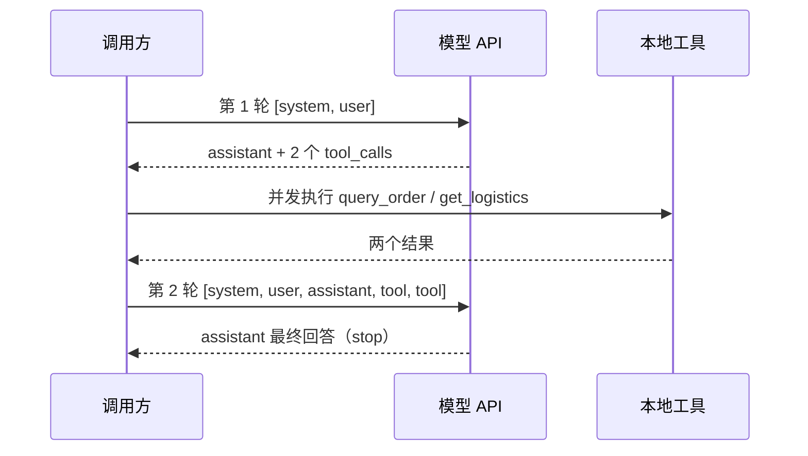

# Day 6 · function calling 会话实测

## 学完后应能

- 说出一次工具调用会话里每条消息的来源与去向：哪些由调用方构造，哪些由模型返回。
- 解释 `finish_reason` 为什么比"有没有 tool_calls 字段"更可靠，以及 length / content_filter 两种非正常结束的处理差异。
- 指出 `arguments` 解析、工具执行、回填配对三个环节各自的失败方式与处理边界。
- 对照两轮请求，解释模型请求、工具执行和历史重发分别发生在哪里。

复盘入口：[tool_call_session.py](../../../phase2/day06/tool_call_session.py)、[协议练习](../../../phase2/day06/protocol.py)、[回填练习](../../../phase2/day06/roundtrip.py)。仓库保留的[会话日志](../../../phase2/day06/logs/session-20261122-154748-371904.json)来自 `scripted-model`：可以验证两轮请求、消息顺序和工具结果配对，但不能验证真实服务商的 token 用量、延迟或兼容性。

## 1. 会话时序：六条消息，两轮请求



`exchanges` 保存每轮的请求与响应。两轮请求分别携带 2 条和 5 条消息；最终历史有 6 条，第 6 条是第 2 轮的回答，没有作为请求发出。本练习在每次 Chat Completions 请求中重发完整 `messages`，因此历史增长会增加提交的上下文；消息条数不能换算成本，离线日志也没有 `usage`。

## 2. 第二轮为什么保留 assistant 请求

本练习的两轮请求都携带 `model`、`messages`、`tools`、`tool_choice`、`parallel_tool_calls`、`max_tokens` 六个字段；只有 `messages` 发生变化。`tools` 描述可用能力，`assistant.tool_calls` 记录本轮实际请求，两者不能互相替代。

| 消息位置 | 来源 | 可在日志中核对的内容 |
|---|---|---|
| 1–2 | 调用方构造 `system`、`user` | 两轮保持不变 |
| 3 | 模型返回 `assistant` | 请求 `query_order`（`call_1`）和 `get_logistics`（`call_2`） |
| 4–5 | 调用方构造两条 `tool` | `tool_call_id` 分别对应 `call_1`、`call_2` |
| 6 | 模型返回最终 `assistant` | 只在第 2 轮响应和最终历史中出现 |

回填不能只发送两条 `tool` 消息：还要保留发出这两个调用的 `assistant` 消息。`tool_call_id` 对应的是调用实例，而不是工具名；同一个工具被调用两次时，两个结果也必须分别配对。练习中的 `asyncio.gather` 按输入顺序返回结果，不以实际完成顺序决定配对。

## 3. 每条消息的字段与边界

### 工具定义同时描述用途和参数

```json
{
  "type": "function",
  "function": {
    "name": "query_order",
    "description": "按订单号查询订单状态。",
    "parameters": {
      "type": "object",
      "properties": {
        "order_id": {"description": "订单号，例如 A1001", "type": "string"}
      },
      "required": ["order_id"]
    }
  }
}
```

`description` 帮助模型选择工具，参数 JSON Schema 描述预期形状。练习由 Pydantic 的 `model_json_schema()` 生成 schema，并在发送前删除 `title`；删除 `title` 是项目约定，不是协议要求。

### 请求与回填的字段对应关系

| 第 1 轮响应中的字段 | 第 2 轮请求中的对应内容 |
|---|---|
| `tool_calls[0].id = "call_1"` | 第一条 `tool` 消息的 `tool_call_id` 为 `"call_1"` |
| `tool_calls[0].function.arguments` | `"{\"order_id\": \"A1001\"}"` 是待解析的 JSON 字符串，不是 Python 字典 |
| `tool_calls[0].function.name = "query_order"` | 调用方按工具名查注册表，执行结果序列化为 `tool.content` |

```json
{
  "role": "tool",
  "tool_call_id": "call_1",
  "content": "{\"ok\": true, \"data\": {\"order_id\": \"A1001\", \"status\": \"已发货\"}}"
}
```

`ok`、`data`、`error` 是本项目工具结果的约定，不是 HTTP 状态码。离线响应中有 `tool_calls` 时 `content` 为 `null`，但练习按 `finish_reason` 分派，不从 `content` 是否为空推断。服务商的扩展字段也要独立核对，例如 [DeepSeek 思考模式](https://api-docs.deepseek.com/guides/thinking_mode) 对含工具的请求另有 `reasoning_content` 回传规则；离线日志未覆盖该行为。

## 4. 按失败发生的位置决定如何处理

| 失败位置 | 本练习的处理 | 原因 |
|---|---|---|
| 模型结束原因 | `stop` 返回答案；`tool_calls` 进入执行；`length` 和 `content_filter` 分别报错 | 没有工具请求不等于正常结束。未知值也不按 `stop` 处理，服务商可能增加结束原因。 |
| 工具名、参数或业务执行 | 未登记的工具、非法 JSON、Pydantic 校验失败、订单不存在均可回填 `error` | 已有调用 ID，模型可以根据错误调整参数或说明无法查询；不保证修正成功。 |
| 调用 ID 或回填契约 | 缺少有效 ID 无法配对；`validate_roundtrip` 发现漏回填、重复或角色错误时，本地终止 | 此时不能构造可信的下一轮请求，不应等服务商拒绝才定位。 |
| HTTP 请求失败 | `raise_for_status()` 抛异常，当前实现不重试 | 未取得可处理的模型响应，不属于本地工具执行失败。 |

参数验证有两层：`json.loads` 检查文本能否解析成 JSON，`model_validate` 检查解析后的值能否构成工具参数。例如 `{"order_id": 1001}` 是合法 JSON，但不满足本练习的字符串字段。类型注解不会替代运行时校验，正如请求体反序列化成功并不等于通过 Java Bean Validation。

工具执行捕获 `Exception`，不会捕获 Python 3.11 的 `asyncio.CancelledError`；取消应继续传播，而不是包装成业务错误。`max_turns` 限制的是模型请求次数，默认 3 轮；达到上限仍未得到 `stop` 时，练习报错，不返回工具结果充当最终答案。

## 5. 如何用日志定位

先在 `exchanges` 找到异常轮，再对照该轮实际请求与上一轮的 `tool_calls`。如果模型反复请求同一个工具，检查返回的 `error` 是否提供了可修正的信息；如果下一轮请求被拒绝，检查回填 ID、消息顺序与服务商字段。`run_session` 复制每轮消息列表，并浅拷贝其中的消息字典，避免后续追加消息改变已记录的请求；这不是递归深拷贝。

```powershell
mise exec -- uv run -m phase2.day06.tool_call_session
```

离线模式应完成两轮并写出日志，只验证应用侧已覆盖的路径。使用 `--real` 时才访问外部服务；结束原因、扩展字段和参数支持范围以所用 API 为准，可对照 [DeepSeek Chat Completions 文档](https://api-docs.deepseek.com/api/create-chat-completion)。

## 自测

- 为什么第二轮请求只有五条消息，而最终历史有六条？
- 同一个工具在一轮中收到两组参数时，如何确保两条结果不会配错？
- 合法 JSON 中的参数类型不符合 schema，与模型没有提供调用 ID，为什么不能用同一种方式处理？
- 离线断言通过后，真实 API 还需要核对哪些行为？
