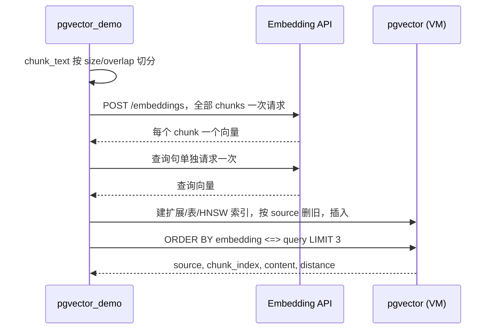

# Day 7 · RAG 检索实测：chunk、embedding、top-k

## 学完后应能

- 说出一次检索前发生的三件事：切 chunk、逐块生成向量、连同文本入库；以及查询时的两件事：查询向量、按距离取 top-k。
- 从实测结果区分三个概念：距离决定排序，top-k 限制数量，相关性需要独立判断。
- 解释切分窗口与重叠长度如何影响证据的完整性，以及哪些问题必须用更长的样本验证。
- 区分 pgvector 扩展、定维向量列和可选 HNSW 索引的职责，说明重跑时哪些数据会被替换。

复盘入口：[pgvector_demo.py](../../../phase2/day07/pgvector_demo.py)、[chunking.py](../../../phase2/day07/chunking.py)、[检索日志](../../../phase2/day07/logs/retrieval-example.json)。日志只覆盖一个查询、两条候选；实验没有测量索引加速效果，也没有评估回答质量。

## 1. 全流程：入库与查询各发生什么



入库与查询都必须经过同一个 embedding 模型：向量是模型对文本的表示，换了模型，新旧向量不在同一个空间里，算出的距离没有意义。日志里 `embedding_model` 与 `embedding_dimensions` 记录的正是这个前提。

## 2. chunk：size 与 overlap 决定检索单元

两篇示例文档都短于 120 个字符，`chunk_text(text, size=120, overlap=20)` 分别生成一块，没有产生相邻块之间的重叠。日志 `chunks` 数组中的两条记录是全部入库单元。

`chunking.py` 的断言覆盖以下窗口边界：

- 文本恰好等于窗口长度时，示例只生成一个 chunk，不重复生成尾块。
- `size=3, overlap=1` 时，`abcdefg` 切成 `abc / cde / efg`，每次推进 `size - overlap` 个字符。
- `overlap=0` 时，同一文本切成 `abc / def / g`，不足整窗的尾部仍可成为 chunk。
- `overlap == size` 时步长为零，因此参数校验拒绝该输入。

重叠只能减少边界切断证据的概率，不能保证保留完整句子。在 `abc / cde / efg` 中，证据 `bcd` 跨越边界，仍不完整地存在于任何一个块中。较大的窗口可能把不同主题引入同一块，较小的窗口可能拆开条件与结论；增加重叠也会重复存储文本，并让相似结果占用 top-k 名额。日志中的短文档没有跨块，因此不能用该日志评估重叠是否有效。

## 3. embedding 与距离：0.218 与 0.629

日志的检索结果，模型 `BAAI/bge-large-zh-v1.5`，1024 维：

| 命中 | distance | 内容 | 判断 |
|---|---|---|---|
| shipping.md#0 | 0.2181 | 发货后在订单详情页查看物流，顺丰单号以 SF 开头 | 相关 |
| returns.md#0 | 0.6289 | 七天无理由退货、生鲜与个人护理除外 | 不相关 |

查询是「订单已经发货，在哪里查顺丰物流单号？」。余弦距离等于 `1 − 余弦相似度`，距离越小，向量方向越接近。物流块排在退货块之前，但 `LIMIT 3` 仍返回两条：top-k 限制数量，不判断相关性。日志中的 `top_k=2` 记录的是实际返回数量，而非 SQL 的请求上限 `3`。

`distance <= 0.5` 只能说明在这次查询里会保留物流块、排除退货块；一个问题和两条候选不能建立阈值。即使模型不变，另一条查询或另一批文档也可能有不同的距离分布。设阈值时应使用多条已标注查询，检查误保留与误过滤。距离也不是答案正确率：内容过时的物流政策仍可能与问题很相似。

## 4. pgvector 侧的三层配置

| 层次 | 本练习的配置 | 改动时检查什么 |
|---|---|---|
| 扩展 | `CREATE EXTENSION IF NOT EXISTS vector` | 安装了 pgvector 的镜像也需要在目标数据库启用扩展；仅运行 SQL 不会安装缺失的扩展文件。 |
| 表 | `embedding vector(1024)` | 建表维度来自入库向量；`CREATE TABLE IF NOT EXISTS` 不会修改旧表。更换模型时，即使维度相同，也不能混用新旧向量。 |
| 索引 | `USING hnsw (embedding vector_cosine_ops)` | HNSW 是可选的近似最近邻索引，可能漏掉精确搜索的候选。日志没有执行计划，不能证明实际用了索引。 |

[pgvector 官方文档](https://github.com/pgvector/pgvector)列出了 `<=>`、索引查询条件和精确／近似搜索的区别。验证索引是否生效应查看 `EXPLAIN`；两条样本只能验证入库和查询结果，不能比较性能或召回损失。

`store_chunks` 在同一事务中按当前 `DOCUMENTS` 的来源删除旧块，再写入新块，因此同一批来源重跑不会让行数翻倍。但如果某个来源从 `DOCUMENTS` 移除，它不会进入删除循环，旧块仍可能被检索到。重跑不重复与同步删除是两个不同的契约。

## 5. 如何复现与定位

先运行离线切分自检。实际检索需要 VMware 中的 pgvector 实例和可用的 Embedding 服务；按 Day 7 README 配置 `PGVECTOR_DSN`、`EMBEDDING_BASE_URL`、`EMBEDDING_MODEL`，服务要求认证时再设置 `EMBEDDING_API_KEY`。

```powershell
mise exec -- uv run phase2/day07/chunking.py
mise exec -- uv run -m phase2.day07.pgvector_demo
```

| 现象 | 先核对什么 |
|---|---|
| 向量可能写到错误文本上 | `embed_texts` 核对响应条数与 `index` 集合，再按 `index` 恢复输入顺序。响应乱序可纠正，缺失或重复则拒绝。 |
| 查询或插入报维度不符 | 对照旧表的列维度、入库向量与查询向量。不要通过截断向量绕过维度不匹配。 |
| 结果文本相关但缺少回答所需的条件 | 检查入库时生成的 chunk 是否已经拆开证据。重新排序无法补回候选集中不存在的内容。 |
| 结果中含不相关块 | 对照候选上限与实际返回量，再用人工标签比较不同阈值或 rerank 设置；本练习只实现向量 top-k。 |

## 自测

- SQL 请求 3 条，为什么日志的 `top_k` 是 2？两条结果都应送给生成模型吗？
- 切分参数相同，保留重叠为什么仍不能保证证据完整？
- 如果更换了同为 1024 维的模型，为什么数据库不报错也不能继续查旧向量？
- 从 `DOCUMENTS` 删除一个来源后重跑，为什么该来源的旧块仍可能被查到？
