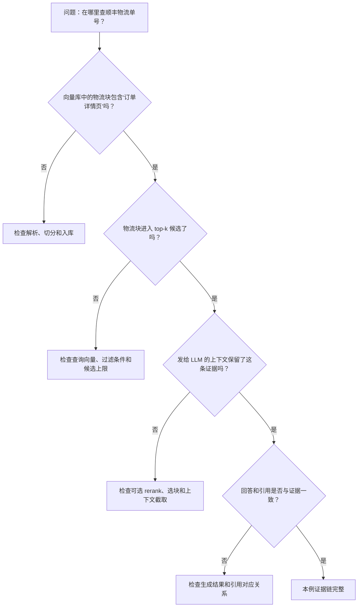

# Day 8 · RAG 全链路、检索评测与 MCP

RAG（检索增强生成）先从知识库找证据，再让模型依据证据回答。Day 7 的物流示例找到了「订单详情页」这条证据，但找到证据、将证据传给模型、生成有据可查的回答，是三个不同的验收点。Day 8 用固定样例区分检索评测与答案评测。脚本只验证检索指标的计算，不访问 pgvector、模型 API 或 MCP Server；MCP 与 function calling 的分层另见 Day 8 练习 README。

## 1. 白板图：定位物流证据丢失的位置

[打开交互流程图](assets/rag-evidence.html)。从向量库开始逐项核对，第一次答「否」的位置就是首要排查点。



图中按处理顺序检查证据。离线入库将文档解析、切分，再将向量与来源一同保存。在线阶段使用兼容的查询向量检索 top-k 候选，可选的 rerank 只重排已有候选，随后按上下文预算选块并生成带引用的回答。Day 7 的日志只能证明物流块进入了候选；上下文、生成与引用是后续检查点，不是本日实测结果。

## 2. 检索评测：先标注证据，再计算指标

Golden set 是人工标注的评测集。正式评测时，每道题保留 `query_id`、问题原文和能支持答案的 chunk ID，标注时以语料为准，不从当前检索结果倒推答案，否则检索器漏掉的证据也可能漏标。以物流问题为例，包含「在订单详情页查看物流」的块是正例；即使退货块也出现「订单」一词，也不能回答这道题。如果一道题需要同时说明规则和例外，应分别标出支持这两项的证据。Day 8 脚本只负责计分，因此 `GoldenCase` 只保存 `query_id` 和 `relevant_ids`，不保存问题原文。

设 `k` 为评测截断位置，`h` 为前 `k` 条结果中命中的不同相关 ID 数。三个指标回答不同的问题：

- **Recall@k（召回率）**：`h / 该题标注的相关 ID 总数`。已知的相关块找回了多少？
- **Hit@k（命中）**：`h > 0` 记为 `1`，否则记为 `0`。至少找回一块了吗？多题平均后表示至少命中一次的问题占比。
- **Precision@k（查准率）**：按本文的固定 `k` 口径计算 `h / k`。分配给前 `k` 条结果的位置中，有多少被相关块占用？

### 手算：Hit@2 满分，仍然可能漏掉证据

以下 ID 来自 `evaluate_retrieval.py` 的固定样例，不是 Day 7 的数据库输出。

| 用例 | 标注的相关 ID | 前 2 条结果（按顺序） | Recall@2 | Hit@2 | Precision@2（手算） |
|---|---|---|---|---|---|
| `q1` | `ship-1`、`ship-2` | `ship-1`、`policy-1` | 1/2 | 1 | 1/2 |
| `q2` | `return-1` | `policy-2`、`return-1` | 1/1 | 1 | 1/2 |
| 按问题取算术平均 | — | — | **0.75** | **1.0** | **0.5** |

`q1` 的 Hit@2 为 1，但漏掉了 `ship-2`。`q2` 找回了全部相关块，Precision@2 仍只有 0.5，因为第 1 个位置被无关块占用。如果将 `q2` 的相关块从第 2 位移到第 1 位，表中的三个 @2 分数都不变，但 Hit@1 从 0 变为 1。若模型只接收第 1 块，这次重排就决定了模型能否看到证据。

脚本先计算每道题的分数，再对问题取算术平均（宏平均），两题权重相同。因此 Recall@2 是 `(1/2 + 1/1) / 2 = 0.75`，不是先汇总命中数再除以标注数得到的 `2/3`。检索指标的定义可对照 [ir_measures 指标文档](https://ir-measur.es/en/latest/measures.html)，其中 `Success@k` 对应本练习的 `Hit@k`。

从仓库根目录运行 `phase2/day08/evaluate_retrieval.py`：

```powershell
mise exec -- uv run phase2/day08/evaluate_retrieval.py
```

脚本只断言 Recall@k 和 Hit@k，终端打印「全部断言通过」，不会打印表格分数；Precision@k 是补充手算项。结果不足 `k` 条时，`[:k]` 只取已有项，不补齐。

- **缺少查询键与返回空列表不是同一件事。** 缺少查询键表示评测程序没有收到这道题的结果，`evaluate` 会报错。`[]` 表示查询已执行但没有返回结果；若该题有标注证据，则两项指标均为 0。
- **空标注不等于零分。** 当前脚本拒绝非正的 `k` 和空相关集合。对语料本身无答案的题，另设「是否明确说明证据不足」的评分规则，不将其计入本练习的召回率。
- **评测输入应保证 ID 不重复。** 当前 Recall@k 按列表中的命中次数计数；若标注只有 `ship-1`，输入 `['ship-1', 'ship-1']` 会得到 `2/1 = 2.0`，这不是有效的召回率。

## 3. 答案评测：区分证据支持与答案正确

即使检索指标满分，也要对照模型**实际收到的上下文**评估回答，而不是用向量库原文替代模型输入。以「订单已经发货，在哪里查顺丰物流单号？」为例，假设模型收到的上下文只有「发货后可以在订单详情页查看物流。顺丰单号通常以 SF 开头。」以下是判分示意，不是模型实测输出。

| 评测维度 | 对照材料 | 示例 |
|---|---|---|
| 正确性与完整性 | 问题、人工参考答案及必答要点 | 「顺丰单号通常以 SF 开头」有证据支持，却没有回答「在哪里查」；必答要点是「订单详情页」。 |
| 忠实性（groundedness） | 回答、实际送入模型的上下文 | 「在订单详情页查看，发货后两小时内显示」答对了入口，但上下文不支持「两小时内」。 |
| 引用支持 | 回答中的关键断言、引用指向的原始片段 | 「在订单详情页查看」若引用了退货条款，断言本身正确，引用仍不合格。 |

参考答案说明「该答什么」，上下文说明「模型有依据说什么」。如果语料仍保留旧政策，回答可能忠实于上下文，却不符合当前事实；正确性需要独立核对。

**LLM-as-judge** 指让评审模型按明确规则判分。在本例中，可让评审模型分别判断「是否给出查询入口」和「是否加入上下文不支持的事实」，每项输出通过或不通过，并指出判分依据。比较不同版本时，记录评审模型版本、提示词和规则，保留问题、参考答案、上下文、回答及判分理由；用人工样例检查判分是否一致。评审模型打分不是事实核验，评分波动也不能直接归因于检索。参见 [Microsoft Foundry：RAG 评估](https://learn.microsoft.com/en-us/azure/foundry/concepts/evaluation-evaluators/rag-evaluators)。

## 4. 回归评测：比较分数之前，固定评测边界

1. **建立基线。** 保存问题与标注、语料版本、评测截断位置 `k`、评测点（初检、重排后或最终上下文）及每题结果。候选上限决定有多少候选可供重排，评测 `k` 决定取前几条计分，上下文预算决定送入模型的文本量，三者不要混为同一参数。
2. **比较单项改动。** 例如只比较是否启用 rerank，保持语料、问题、标注、候选上限和评测 `k` 不变。若改动本身是重新切分，chunk ID 可能改变；应按同一文档的原文位置重新映射或标注证据，不能直接用旧 ID 判定漏检。
3. **查看逐题差异。** 均值不变也可能有题目退化。对照同一道题的初检列表、重排结果与最终上下文：初检没有证据，检查入库、过滤和检索；候选有证据但模型输入没有，检查重排、选块和截取；输入有证据但答案仍错，检查生成与引用。

也可固定问题、模型和提示词，只将实际上下文换成人工确认的证据，再比较回答。如果换入证据后答对，应优先检查证据是否在上游丢失；若仍答错，至少说明缺失证据不能单独解释问题。Day 8 没有运行这项对照实验，脚本断言通过只代表固定样例的指标计算符合预期。

## 自测

- 如果某个问题的 Hit@5 为 1、Recall@5 为 0.25，能据此判断答案正确吗？如果不能，下一步检查哪份数据？
- 同一条相关证据从第 3 位移到第 1 位，Recall@3 为什么可能不变？如果应用只送第 1 块给模型，应在什么位置记录评测结果？
- 回答准确转述了已过期的政策，忠实性与正确性的判分会相同吗？应分别对照什么材料？
