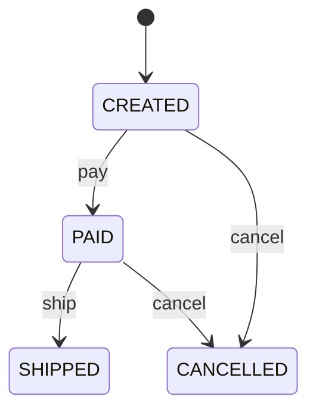

# Day 1 · Java 到 Python：先校准对象与运行时模型

## 学习目标

读完后先做练习：把 Java 的订单状态机迁移成 Python，并能解释默认参数、对象相等、字段归属和类型注解的关键差异。不要把 Java 语法逐字翻译成 Python 语法。

## 1. 函数默认参数与对象生命周期

Python 在执行 `def` 语句时计算默认值，并把结果保存在函数对象上。若默认值是可变对象，后续调用会共享同一对象。

```python
def add(item: str, bucket: list[str] = []) -> list[str]:
    bucket.append(item)
    return bucket


add("a")  # ['a']
add("b")  # ['a', 'b']，继续修改同一个列表
```

Java 没有方法参数默认值，常见替代是重载。Python 通常用 `None` 表示“调用者没有传入”，在函数体内创建新列表。

```python
def add(item: str, bucket: list[str] | None = None) -> list[str]:
    if bucket is None:
        bucket = []
    bucket.append(item)
    return bucket
```

## 2. 身份、相等与真值

`==` 比较值，行为由类型的 `__eq__` 决定。普通 Python 类默认按对象身份比较。`is` 直接判断两个名称是否指向同一对象，通常用于与 `None` 比较。

```python
a = [1, 2]
b = [1, 2]
a == b  # True，内容相等
a is b  # False，不是同一个 list
```

Python 的条件表达式会根据对象的真值决定分支。`None`、`False`、数值零和空容器为假，非空容器为真。

```python
bool([])  # False
bool([0])  # True，容器非空
```

如果逻辑要区分“未提供”和“提供了空列表”，应写 `value is None`，不能用 `if not value`。

## 3. 类字段、实例字段与类型注解

类体中执行 `tags = []` 会创建共享的类属性；`self.tags = []` 会在每个对象上创建实例属性。只有注解的 `tags: list[str]` 不会创建列表值。

类型注解本身不会在 Python 运行时拒绝错误值。mypy 等工具可以在静态检查时使用注解，Pydantic 则会在显式验证数据时执行运行时校验。可空性与参数是否可省略也要分开看：`x: str | None` 允许显式传入 `None`，默认值才决定调用时能否省略参数。

## 4. 用业务方法保护状态不变量

Java 原版订单有 `CREATED`、`PAID`、`SHIPPED`、`CANCELLED` 四个状态。`pay` 只允许 `CREATED → PAID`，`ship` 只允许 `PAID → SHIPPED`，`cancel` 允许 `CREATED` 或 `PAID` 进入 `CANCELLED`。



Python 版本用 `@property` 提供只读的 `state`，由 `pay`、`ship`、`cancel` 更新内部字段。Python 的下划线只是“内部使用”的约定，不是 Java `private` 的访问控制；不变量依赖调用约定与业务方法，而非编译器阻止外部访问。

`apply(event)` 再把字符串事件映射到方法。未知事件是分发失败，当前状态不允许操作是状态转换失败，两者是不同错误。

## 5. 本日还会遇到的迁移差异

- `@property` 提供属性式访问，可用来实现受控读写，不等同于字段。
- 定义 `__eq__` 而不定义 `__hash__` 时，Python 通常会让对象不可哈希。若对象可哈希，必须满足相等对象有相等哈希。
- `@dataclass` 默认生成按字段比较的 `__eq__`。是否使用应由对象比较语义决定，不能只看样板代码多少。
- 对整数操作数，Python `/` 返回浮点商；`//` 向负无穷取整，余数与除数同号。Java 整数除法向零截断。
- `import` 由 `sys.path` 中的搜索位置解析；`pyproject.toml` 声明依赖，`uv.lock` 记录解析结果。
- 本仓库使用四空格缩进。CPython 3.11 的 GIL 与异步 I/O 先作区分，Day 3 再讲事件循环。

## 练习顺序

1. 对照 [Java Order](java/Order.java)，先列出状态和允许的转换。
2. 阅读 [批注版 Python](python/order.py)，逐一解释每处差异及其后果。
3. 阅读 [标准版 Python](python/order_bean.py)，观察移除批注后如何组织业务方法、属性和历史。
4. 运行 `uv run phase1/day01/python/order.py`、`order_bean.py` 与 `demos.py`。

完成练习后，再用 [Day 1 笔记](../../notes/phase1/day01/java-python-diff.md)复盘边界和自测题。
