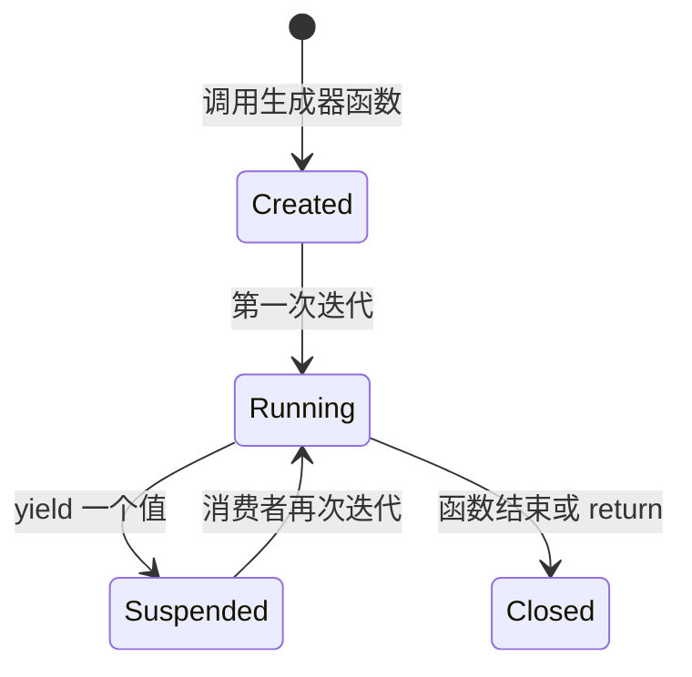
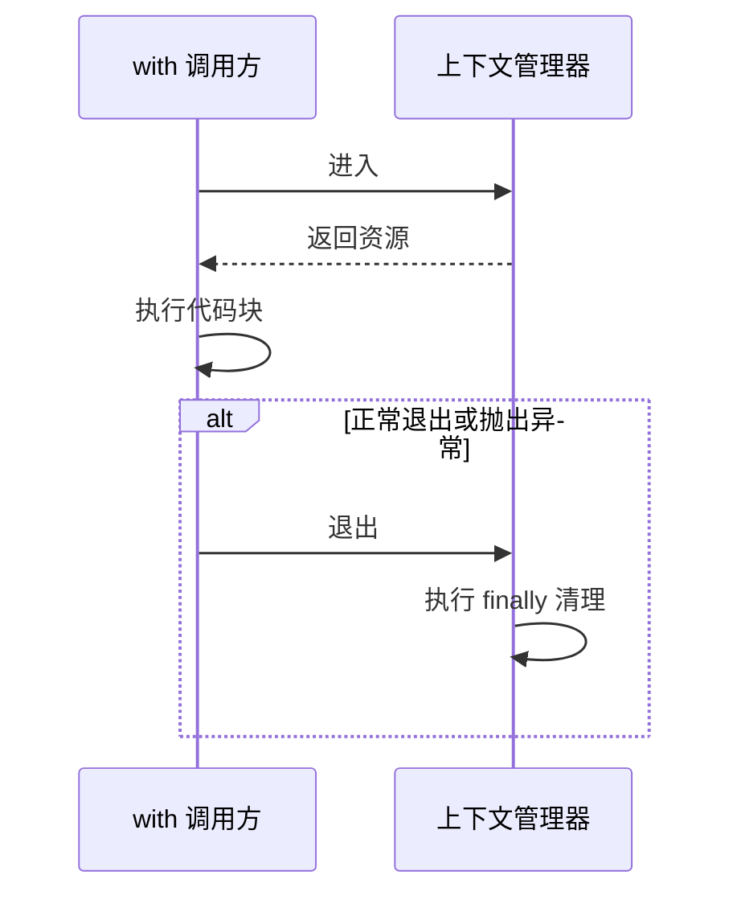
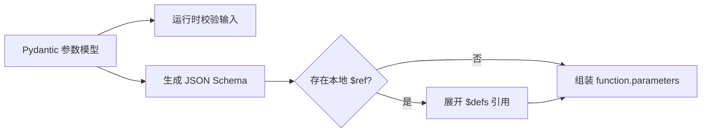

# Day 2 · 函数、迭代与类型边界

## 学习目标

本日围绕三个问题展开：函数如何被传递和包装，数据如何按需产生，类型信息由谁检查。最后将 Pydantic 参数模型转换成工具 schema，为 Day 6 的 function calling 做准备。

## 1. 装饰器：定义时替换函数名称

```python
@timer
def work() -> str:
    return "done"
```

装饰器表达式在执行 `def` 语句时求值，效果近似 `work = timer(work)`。`timer` 决定新名称 `work` 指向原函数、wrapper，还是其他对象。wrapper 才在后续每次调用时运行。

带配置的 `@retry(times=3)` 多一层工厂调用。`functools.wraps` 保存常用元数据并设置 `__wrapped__`，帮助调试、测试和框架读取原函数信息。

## 2. 生成器：把迭代状态交给消费者

含 `yield` 的函数调用后返回生成器对象，函数体尚未运行。`next()`、`for` 或 `list()` 推进生成器，执行到 `yield` 时产出一个值并暂停。



生成器适合逐步处理大数据或流式结果，不必一次构造完整列表。每个生成器通常是一次性迭代器。`return value` 结束生成，普通 `for` 不会把返回值当成元素。

本日练习的 `iter_chunks` 用 `size` 控制块长，用 `overlap` 定义相邻块重复的字符数。边界条件必须以“每个输入字符应落在哪些块中”来推导，不能只看循环步长。

## 3. 上下文管理器：把资源退出与进入配对

`with` 使用 `__enter__` / `__exit__` 协议。退出方法会在正常路径和异常路径执行，可用来释放资源。`contextlib.contextmanager` 将生成器函数转换成上下文管理器工厂，`yield` 前后分别对应进入和退出阶段。



若需要抑制异常，必须明确处理异常并遵守协议。清理放进 `finally`，才能覆盖异常退出；Day 3 会把同一原则用于异步取消。

## 4. 类型信息：静态检查与运行时校验

- 类型注解表达预期，不会自动拒绝错误实参。
- mypy 在运行前分析类型关系。`Protocol` 描述静态结构，`Generic[T]` 传递类型参数。
- Pydantic 在显式校验数据时执行运行时检查，也可读取模型定义生成 JSON Schema。

`T | None` 表示允许传入 `None`。参数是否可以省略仍由默认值决定。`Any` 会放宽静态检查，不等同于 Java 的 `Object`。

## 5. 工具参数模型与 JSON Schema

`tool_schema.py` 将 Pydantic 模型转换为 function calling 使用的 `parameters`。Pydantic 生成 schema 时，简单字段通常直接内联；可复用的嵌套定义可能放入 `$defs`，再由 `$ref` 指向。练习中的转换器仅处理简单本地引用，并以合成 schema 验证递归展开。



目标模型 API 对 JSON Schema 的支持范围取决于协议和调用模式。展开引用是本练习的转换策略，不是所有服务共同要求。

## 代码入口

| 文件 | 关注的机制 |
|---|---|
| `python/decorators.py` | 装饰器定义时行为与调用时行为 |
| `python/generators.py` | 惰性迭代、重叠分块、边界校验 |
| `python/context.py` | 手写协议与 `@contextmanager` |
| `python/typing_practice.py` | `Protocol`、`Generic[T]` 与静态检查 |
| `python/tool_schema.py` | Pydantic 校验、schema 生成与简单 `$ref` 展开 |

运行方式为 `uv run phase1/day02/python/<文件名>.py`。完成练习后，再用 [Day 2 笔记](../../notes/phase1/day02/python-functions-typing.md)梳理边界并做主动回忆。
