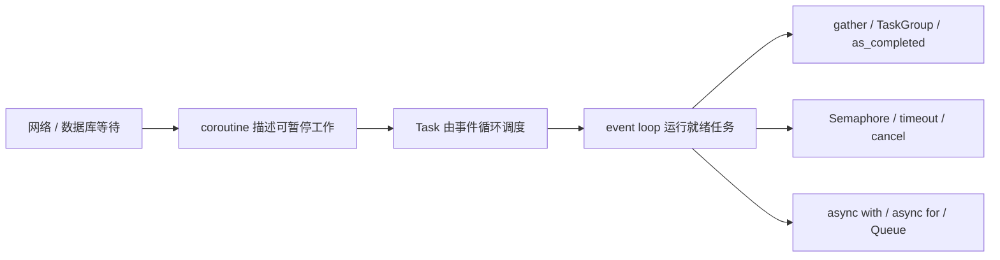

# Day 3 · asyncio：让等待期间的工作重叠

## 学习目标

理解 coroutine、Task 和事件循环如何协作；能选择等待一组任务的方式，并能在并发请求中限制数量、处理超时、关闭资源。

## 1. 并发解决的是等待，不是 CPU 计算

Agent 客户端通常花很少时间构造 HTTP 请求，却会等待模型或数据库返回。异步 I/O 允许 Task 在等待时让出控制权，让同一个事件循环线程执行其他就绪 Task。它提高的是等待资源的利用率，不会让多个 Python Task 同时执行字节码。



CPU 密集计算没有 I/O 等待可让出，改写成 `async def` 不会自动变快。需要并行计算时应评估进程池、线程池或原生扩展。

## 2. 四个对象的关系

| 对象 | 作用 | 创建方式 |
|---|---|---|
| coroutine | 保存异步函数执行状态 | 调用 `async def` 函数 |
| Task | 交由事件循环调度的工作单元 | `asyncio.create_task(coro)` |
| Future | 表示稍后可读取的结果 | 通常由库或事件循环创建 |
| event loop | 推进 Task、处理 I/O 就绪回调 | `asyncio.run(main())` 启动 |

调用 `async def` 只创建 coroutine，函数体尚未运行。`create_task` 会创建并排期 Task，但不会在调用处内联执行。事件循环要等当前 Task 让出控制权后才会运行其他 Task。

```python
import asyncio


async def fetch(name: str) -> str:
    await asyncio.sleep(0.1)
    return name


async def main() -> None:
    first = asyncio.create_task(fetch("first"))
    second = asyncio.create_task(fetch("second"))
    print(await asyncio.gather(first, second))


asyncio.run(main())
```

`await coroutine` 不创建新 Task。coroutine 在当前 Task 的调用链中执行，内部遇到未就绪的异步操作时，当前 Task 才可能挂起。`await task` 则等待另一个已排期的 Task。

## 3. 收集结果时选择正确的语义

- `asyncio.gather(*items)` 等所有结果并按参数顺序返回。默认情况下一个 awaitable 抛异常时，异常传播给调用方，其他 awaitable 不会因此自动取消。
- `asyncio.TaskGroup` 在作用域内管理子任务。Python 3.11 中子任务发生非取消异常时，TaskGroup 会取消仍运行的兄弟任务、等待清理，再传播异常组。
- `asyncio.as_completed(items)` 允许先处理先完成的结果。Python 3.11 中普通迭代得到的元素还需 `await`；较新版本也支持异步迭代。

若任务间没有依赖且等待 I/O，可并发安排。若某步必须读取上一步结果，应显式按顺序 `await`，不要为了“并发”把有依赖的工作拆开。

## 4. 限流、等待通知与取消

`Semaphore(n)` 限制同时进入某段工作的 Task 数，适合限制并发 HTTP 请求。`Lock` 用于保护共享状态的互斥访问；`Event` 用于通知一个或多个 Task 某个条件已满足。它们解决不同问题，不能互相替代。

`asyncio.timeout(seconds)` 限制一段操作的总时长。超时会请求取消当前 Task，并在上下文边界转换为 `TimeoutError`。`task.cancel()` 本身是取消请求，协程通常在可取消的等待点收到 `CancelledError`。清理放在 `finally` 或上下文管理器中，随后通常让取消继续传播。

## 5. 异步资源和流

- `async with` 使用 `__aenter__` / `__aexit__` 管理异步资源，适合 HTTP client、异步连接等生命周期。
- `async for` 消费实现异步迭代协议的对象，例如异步生成器；普通 list 使用同步 `for`。
- `asyncio.Queue(maxsize=n)` 在队列满时让 `put()` 等待，可形成生产者背压。`maxsize` 是配置上限，不是实际观测到的峰值。
- `asyncio.to_thread(func, ...)` 可把阻塞的同步函数移到线程中运行；它不适合用来加速纯 Python CPU 密集计算。

HTTP client 应在覆盖一组请求的生命周期内创建并关闭。为每个 URL 新建 client 会失去连接池复用。

## 6. 对照代码学习

| 顺序 | 文件 | 用途 |
|---|---|---|
| `00_trace.py` | 追踪 coroutine 创建、Task 排期与 `await` 挂起 |
| `01_coroutine.py` | 观察 coroutine 状态 |
| `02_task.py` | 比较顺序等待与并发等待 |
| `03_control.py` | 验证 gather、TaskGroup、timeout、cancel |
| `04_resources.py` | 学习异步上下文管理器、迭代器与 Queue |
| `05_fetch.py` | 组合 AsyncClient、Semaphore、timeout 与 gather |

运行 `uv run phase1/day03/python/05_fetch.py` 使用本地 MockTransport；加 `--real` 才会请求公共 API。练习结束后，再读 [Day 3 笔记](../../notes/phase1/day03/asyncio-concurrency.md)复盘异常传播和取消边界。
