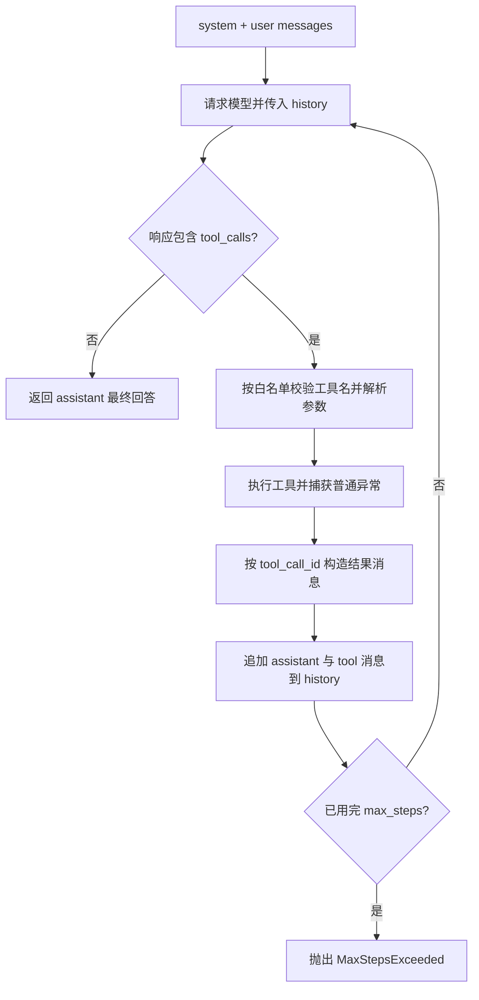

# Day 5 · mini Agent 工具调用循环

今天把前四天的消息结构、函数调用、异步 I/O 和测试组合起来。这个练习定义了一个最小 Agent harness：模型返回普通答案时结束，返回工具请求时由程序执行工具并把结果放回消息历史。

## 核心数据流



模型只提出结构化请求。工具是否存在、参数是否有效、如何执行、异常是否转成工具结果、何时停止，都由调用方控制。

## 消息角色与工具配对

| role | 内容来源 | 在循环中的作用 |
|---|---|---|
| `system` | 调用方 | 设置助手行为约束 |
| `user` | 用户 | 提供本轮问题 |
| `assistant` | 模型 | 返回答案或 `tool_calls` |
| `tool` | 调用方 | 返回工具结果，并携带对应的 `tool_call_id` |

工具请求中的 `arguments` 是 JSON 文本。程序先解析文本，再查工具白名单并调用函数。解析成功只代表 JSON 语法正确，还需要处理未知工具名、缺失参数和不符合业务规则的值。

```json
{
  "role": "tool",
  "tool_call_id": "call_1",
  "content": "{\"ok\": true, \"data\": {\"status\": \"已发货\"}}"
}
```

每个 assistant 工具请求都需要一条带相同 `tool_call_id` 的工具结果。模型一次返回多个工具调用时，调用方必须逐个执行或逐个返回错误，不能只回填成功的部分。

## 概念顺序

1. **消息协议**：`system`、`user`、`assistant`、`tool` 的职责，以及 `tool_call_id` 如何关联请求和结果。
2. **注册表**：模型给出的工具名只能映射到明确登记的函数。未知名称作为错误结果处理。
3. **参数解析**：`arguments` 是 JSON 文本，需要解析后才能调用 Python 函数。合法 JSON 不代表类型和业务约束已经通过验证。
4. **执行与回填**：只读并发是本练习的策略，写工具串行执行；回填结果按原调用顺序排列，并保留各自 id。
5. **循环终止**：无工具请求时结束；工具调用轮数受 `max_steps` 限制。

工具执行抛出的普通异常在本练习中会被转成 `{"ok": false, ...}` 的工具消息，让模型有机会据此调整。取消异常需要继续传播，否则调用方的取消请求可能失效。

## 文件关系

| 文件 | 作用 |
|---|---|
| `python/01_messages.py` | 独立练习消息构造、结果配对和历史追加 |
| `python/02_registry.py` | 独立练习 `@tool` 注册、schema 生成与工具分发 |
| `python/mini_loop.py` | 当天主产出，整合循环、假模型、工具执行与验收 |

三个文件按概念顺序学习。`mini_loop.py` 为便于单独运行，在文件内定义了自己的消息构造和 `TOOLS` 映射；它没有导入前两个练习模块。它也没有使用 `@tool` 装饰器，装饰器注册在 `02_registry.py` 中单独演示。

## 本练习的简化边界

- `Model` 是同步的脚本化假模型，按顺序返回预设响应。接入 Day 6 的异步 HTTP API 时，需要将模型调用接口改成可等待，并按 API 协议检查 `finish_reason` 等字段。
- 本循环把没有 `tool_calls` 的响应视为最终答案。真实服务还可能返回截断或内容过滤等结束原因，不能只依据这个简化条件。
- 执行器先并发执行只读工具，再串行执行写工具，最后恢复回填顺序。混合读写请求的实际执行顺序不保证等于模型返回顺序，因此本练习假设读操作不依赖同批写操作。
- 只读/写入分类是示例策略。生产系统还要考虑权限、幂等、重试、审计和人工确认。
- 读操作通过 `asyncio.gather` 并发等待；写工具按本练习的分组顺序串行执行。`gather` 保证返回结果按参数顺序排列，不代表工具按这个顺序完成。

## 阅读与验收

先阅读 `01_messages.py` 与 `02_registry.py`，再运行：

```bash
uv run phase1/day05/python/mini_loop.py
```

检查单工具调用、只读并发、未知工具回填、历史回传与最大步数五条路径。完成后应能不看代码画出一次工具调用的消息顺序，并解释为什么每个工具结果都要带回对应的 `tool_call_id`。

详细协议和边界见 [mini Agent loop 笔记](../../notes/phase1/day05/mini-agent-loop.md)。
