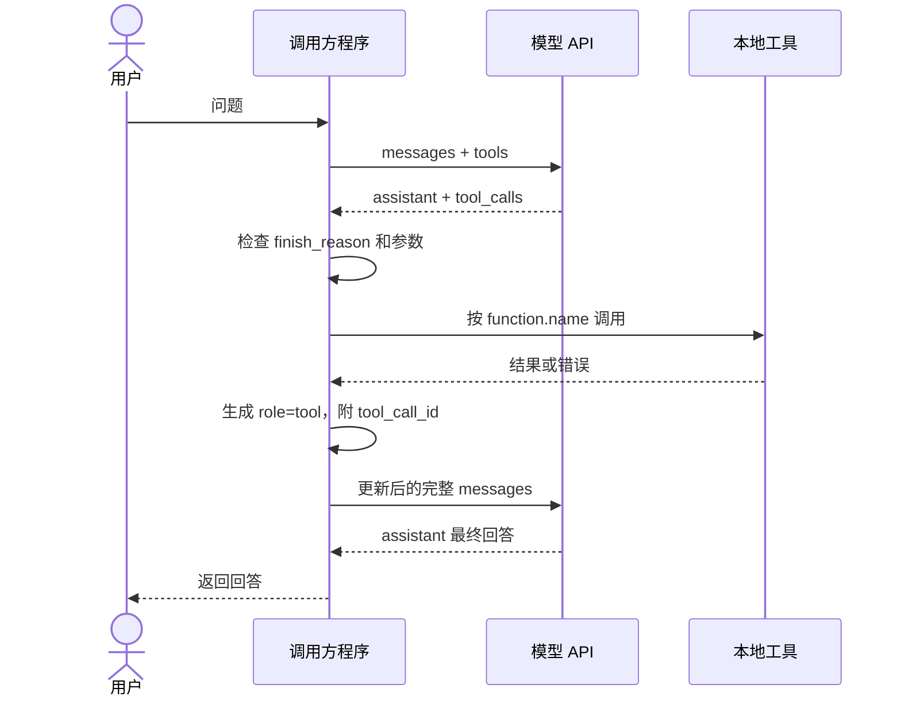

# Day 6 · Function Calling：模型提出请求，程序执行工具

## 学习目标

读完后能追踪一次工具调用的请求、响应、执行和回填；能区分“模型要调用工具”和“程序真的调用函数”；能根据结束原因决定继续、返回或报错。

Function Calling 是模型输出与调用方程序之间的协议。模型返回结构化的工具请求，但不会执行本地 Python 函数。调用方负责校验工具名和参数、执行工具、按 ID 回填结果，再把完整历史发给模型。



## 1. 请求：描述可用工具

请求包含 `messages` 和 `tools`。每个工具定义含 `name`、`description` 与参数 JSON Schema；模型据此选择工具并生成参数。`tool_choice` 控制是否允许、要求或禁止调用，具体支持范围要以所用 API 为准。

```json
{
  "type": "function",
  "function": {
    "name": "query_order",
    "description": "按订单号查询订单状态",
    "parameters": {
      "type": "object",
      "properties": {
        "order_id": {"type": "string", "description": "订单号"}
      },
      "required": ["order_id"]
    }
  }
}
```

Pydantic 可以校验输入并生成 JSON Schema。工具名必须和调用方注册表里的可执行函数对应。参数 schema 限制模型应生成的形状，但不能代替调用方对权限和业务规则的检查。

## 2. 响应：区分工具请求和最终答案

Chat Completions 响应中的 assistant message 可能包含 `tool_calls`。每个调用有 `id`、`function.name` 和 JSON 字符串形式的 `function.arguments`。

| `finish_reason` | 调用方动作 |
|---|---|
| `tool_calls` | 解析并执行工具，然后回填 |
| `stop` | 返回最终答案 |
| `length` | 响应可能被截断，按未完成处理 |
| `content_filter` | 按过滤结果处理，不当作普通答案 |

字段与结束原因要一起判断。没有 `tool_calls` 不足以证明响应是可返回的最终答案。兼容 OpenAI 的服务可能有额外结束原因，代码应对未知值明确报错或按服务文档处理。

## 3. 执行和回填：用 ID 配对

模型输出不可信。调用方只允许执行注册表中的工具；JSON 解析成功后仍需校验字段、类型和业务约束。工具执行失败也可以转成 `role: "tool"` 的错误内容，让模型根据错误决定下一步。

```json
{
  "role": "tool",
  "tool_call_id": "call_1",
  "content": "{\"ok\": true, \"data\": {\"status\": \"已发货\"}}"
}
```

assistant 每请求一次工具，就需要一条对应 `tool_call_id` 的回填消息。调用方把 assistant 请求与工具结果都追加到 `messages`，下一轮继续传入完整历史。

一次响应可能请求多个工具。只有互相独立、可并行的只读工具才适合并发；回填结果仍需按 ID 关联。写操作是否串行取决于副作用和数据依赖，不是协议强制规定。

## 练习顺序

| 文件 | 目标 | 验收 |
|---|---|---|
| `protocol.py` | 生成工具 schema、解析 `finish_reason` 与 `tool_calls` | 固定响应自检通过；这是已完成的协议练习 |
| `roundtrip.py` | 构造 tool 结果并检查请求与回填 ID 是否一一对应 | TODO 完成后，完整、漏回填、多回填和错误 role 用例都通过 |
| `tool_call_session.py` | 将协议接入完整多轮会话 | 完成 roundtrip 后，默认离线流程走完两轮并保存请求/响应；`--real` 才访问外部 API |

先运行已完成的协议练习，再实现 `roundtrip.py` 中的两个函数。roundtrip 脚本在 TODO 完成前会按预期抛出 `NotImplementedError`。完成后运行离线完整会话：

```bash
uv run python -m phase2.day06.protocol
uv run python -m phase2.day06.roundtrip
uv run python -m phase2.day06.tool_call_session
```

真实 API 验证使用 `--real`，并需要 `OPENAI_BASE_URL`、`OPENAI_API_KEY`、`OPENAI_MODEL`。默认离线模式不依赖 API key、旧日志或网络。会话日志写入 `phase2/day06/logs/`。完成离线检查后再进行一次真机请求，核对实际 provider 的 `finish_reason`、参数格式和回填 ID。

练习完成后，再整理笔记：记录实际响应结构、协议兼容差异、工具失败与 finish reason 的处理边界。
