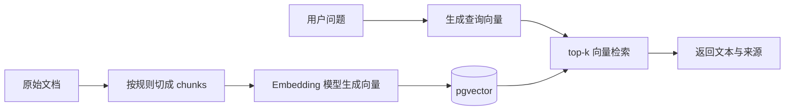

# Day 7 · RAG 检索：从文本到 top-k

## 学习目标

理解 chunk、embedding、向量距离和近似索引之间的关系；实现固定窗口切分，并运行一个将 chunks 写入 pgvector、再按查询返回 top-k 的检索 demo。

## 1. 让文档变成可检索的数据



索引阶段和查询阶段必须使用同一 embedding 模型与相同向量维度。向量表达的是模型对文本的表示，向量库负责存储和按距离查找，并不理解文本含义。

## 2. Chunking 决定检索单元

一个 chunk 太大时，检索结果可能混入无关内容，也会增加送入模型的 token；太小时，定义、条件或指代关系可能被切断。常用起点有：

- 固定窗口：按字符或 token 数切，行为可预测，但可能切开句子。
- 按结构切：优先按标题、段落、代码块等边界切，再对超长块拆分。
- 语义切分：根据主题变化决定边界，效果依赖分段方法与数据。
- overlap：在相邻窗口重复少量内容，减少边界处的语义断裂，但增加存储和重复检索。

本日练习先实现固定字符窗口。字符数不等于 token 数，这个策略用于掌握窗口和 overlap 的边界，不代表生产环境的最佳 chunk 规则。

`chunking.py` 需要处理空文本、最后一块不足窗口长度、overlap 范围以及不重复尾块。文件内断言给出验收例子；TODO 完成前运行会抛出 `NotImplementedError`。

## 3. Embedding 与距离

Embedding 模型将文本映射为固定长度的数值向量。语义相近的文本通常具有较小的 cosine distance，但距离只是模型空间中的相似度信号，不是答案正确性的概率。

pgvector 的 `<=>` 运算符返回 cosine distance，查询按距离升序取 top-k。HNSW 和 IVFFlat 是近似最近邻索引：HNSW 通常用更多内存和构建时间换取较快查询；IVFFlat 需要选择 lists 并依赖聚类，构建和资源特征不同。向量模型的维数、索引类型和 pgvector 限制必须匹配；示例使用的 HNSW cosine 索引维数不超过 2000。

检索后的 rerank 是单独的第二阶段：它用更精细的模型重排候选 chunks，不等同于向量数据库中的距离排序。本 demo 只实现向量 top-k。

## 4. pgvector 集成环境

Day 7 使用根项目的 pgvector 与 psycopg 依赖。依赖变更后同步环境：

```powershell
uv sync
```

Docker 只在 VMware 虚拟机中。进入虚拟机，通过共享目录或已克隆的仓库启动数据库：

```bash
docker compose -f phase2/day07/compose.yaml up -d
```

compose 使用开发环境账号 `agent` 和数据库 `rag_lab`，只用于本地学习。Windows 宿主机运行 Python demo 时，DSN 中的主机名使用虚拟机 IP，并确保虚拟机映射的 5432 端口可从宿主机访问。

```powershell
$env:PGVECTOR_DSN = "postgresql://agent:agent_dev_only@<VM_IP>:5432/rag_lab"
$env:EMBEDDING_BASE_URL = "https://<embedding-service>/v1"
$env:EMBEDDING_MODEL = "<embedding-model>"
$env:EMBEDDING_API_KEY = "<key-if-required>"
```

embedding endpoint 需兼容 OpenAI 的 `/embeddings` 请求与响应格式，并选择不超过 2000 维的模型以满足本 demo 的 HNSW cosine 索引上限。不要将 API key 写入 README、源码或日志。

## 5. 练习入口

| 文件 | 学习目标 | 验收 |
|---|---|---|
| `chunking.py` | 实现固定窗口和 overlap 边界 | 运行脚本，所有断言通过 |
| `pgvector_demo.py` | 调 embedding API，写入 pgvector 并查询 top-k | 输出来源、距离和文本；重复运行不会留下旧 chunks |
| `compose.yaml` | 在 VM 中提供 pgvector 数据库 | Postgres healthy，宿主机 DSN 可连接 |

先完成离线 chunking，再配置服务运行集成 demo：

```powershell
uv run phase2/day07/chunking.py
uv run python -m phase2.day07.pgvector_demo
```

第二条命令依赖 VMware 中的数据库和 embedding 服务，本机离线检查只验证 chunking 逻辑。
