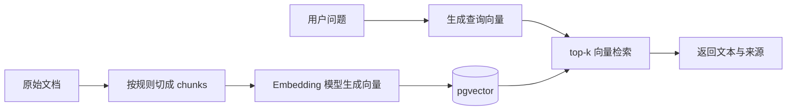

# Day 7 · RAG 检索：从文本到 top-k

## 学习目标

理解 chunk、embedding、向量距离和近似索引之间的关系；实现固定窗口切分，并运行一个将 chunks 写入 pgvector、再按查询返回 top-k 的检索 demo。

## 0. RAG 要解决的问题

用户问模型"退货政策是什么"，模型回答的是**训练数据里的**退货政策——可能过时、可能是别家的、可能编造。私有知识库里有正确答案，模型却读不到。

把知识库喂给模型有两条路：

| 路线 | 做法 | 结论 |
|---|---|---|
| 全塞进上下文 | 整个知识库放进 system prompt | 知识库几百 MB，上下文窗口几十 K token，塞不下；塞得下也贵到不可行 |
| **RAG** | 先检索出**相关的几段**，只把这几段放进上下文 | 每次只送几百 token，内容恰好与问题相关 |

RAG = Retrieval-Augmented Generation，检索增强生成：**生成之前先检索**。核心判断是——模型不需要"记住"知识库，它只需要在回答时"看到"相关的那几段。

整条链路的一切设计都在服务同一个目标：**让"相关的几段"以最少的 token、最高的准确率进入模型的上下文窗口**。下面每个环节（chunk 怎么切、embedding 选哪个、索引用哪种）都是在回答这个问题的某一部分。

## 1. 为什么不能只用关键词搜索

查询"订单已经发货，在哪里查顺丰物流单号？"能被关键词命中——查询和文档共用了"物流"这样的字面词。但换成"快递到哪了怎么查？"，关键词全对不上（"快递"≠"物流"，"到哪了"≠"单号"），一条都搜不到。

**意思相同、字面不同的两句话**，关键词搜索无能为力。这就是需要 embedding 的原因：换一种表示文本的方式——不存字符串，而是把每段文本压成一个固定长度的数字向量。向量的关键性质是训练得来的：**语义相近的文本，向量在空间里就靠近**。"查物流单号"和"快递到哪了"字面不同，向量距离却近。

检索于是变成数学题：查询也变成向量，在库里找距离最近的 k 条。

## 2. 全流程：入库与查询



分两个阶段。**入库**（离线，一次或定期）：文档切 chunk → 逐块生成向量 → 连文本带向量入库。**查询**（在线，每次提问）：问题生成向量 → 按距离取 top-k → 返回文本与来源。

索引阶段和查询阶段必须使用同一 embedding 模型与相同向量维度。向量是模型对文本的表示，换模型等于换坐标系——旧向量和新查询算出的距离没有意义。向量库只负责存储和按距离查找，不理解文本含义。

本日 demo 跑到 top-k 为止；检索结果拼进 prompt 给模型生成答案，是 Day 8 白板图要补的另一半。

## 3. Chunking 决定检索单元

检索的最小单位是 chunk。为什么不把整篇文档存成一个向量？一个向量只能表示**一段文本的整体语义**：整篇售后文档（退货、物流、发票混在一起）压成一个向量后"什么都沾一点"——查物流它距离 0.4，查退货它也 0.4，对什么都不精确。切成小块后，"顺丰单号以 SF 开头"这一块的向量才能和物流查询贴得很近。

切分粒度是**检索精度和信息完整度的权衡**：

- size 过大：每块混入多个主题，命中的块一半是噪声，token 又贵
- size 过小：句子和指代被切断，"它支持七天退货"的"它"留在上一个块里，命中了也没法用
- overlap：相邻块共享少量内容，跨边界的句子至少在一个块里完整，代价是存储重复

常用起点有：

- 固定窗口：按字符或 token 数切，行为可预测，但可能切开句子。
- 按结构切：优先按标题、段落、代码块等边界切，再对超长块拆分。
- 语义切分：根据主题变化决定边界，效果依赖分段方法与数据。

本日练习先实现固定字符窗口。字符数不等于 token 数，这个策略用于掌握窗口和 overlap 的边界，不代表生产环境的最佳 chunk 规则。

`chunking.py` 需要处理空文本、最后一块不足窗口长度、overlap 范围以及不重复尾块。文件内断言给出验收例子；TODO 完成前运行会抛出 `NotImplementedError`。

## 4. Embedding 与距离

Embedding 模型将文本映射为固定长度的数值向量。语义相近的文本通常具有较小的 cosine distance。

cosine distance = 1 − 余弦相似度，衡量两个向量**方向的夹角**，不看长度：完全同向 distance=0，垂直（无关）=1，反向=2。直觉校准：查询与正确文档通常在 0.2 量级，与无关文档在 0.6 量级——这个区间是后面设相似度阈值的依据。两个边界：distance 是模型空间里的相似度信号，**不是答案正确性的概率**——库里放一条错误的退货政策，它的 distance 照样是 0.2，检索只负责"找相关的"，不负责"找对的"；数字绑定当前模型，换模型后区间整体平移，校准要重做。

pgvector 的 `<=>` 运算符返回 cosine distance，查询按距离升序取 top-k；结果不足 k 条时返回全部，不报错。

## 5. 为什么需要近似索引

库里 2 条数据时，逐条算距离毫秒级完成。10 万条 chunk 时，每次查询都要对全部向量算 1024 维点积，单次查询秒级起——逐条扫描撑不住生产负载。

HNSW（Hierarchical Navigable Small World）是**近似最近邻**索引：把向量组织成多层图，顶层稀疏、底层稠密，查询自顶向下贪心跳，每层只走几步就逼近目标区域。代价与收益：

- 查询快：不再逐条比较，百万级数据毫秒级返回
- 近似：可能漏掉真正的最近邻（召回率 95-99%），用精度换速度
- 内存与构建：图结构常驻内存，写入时更新图，比裸存储更贵

选型直觉：10 万条以下、查询不频繁，不建索引（精确扫描足够）；百万级、高 QPS，HNSW。IVFFlat 是另一条路——先聚类，查询只搜最近的几个簇，构建快、内存省，但要先有数据才能训练聚类中心。示例使用的 HNSW cosine 索引维数不超过 2000。

## 6. pgvector 集成环境

Day 7 使用根项目的 pgvector 与 psycopg 依赖。依赖变更后同步环境：

```powershell
uv sync
```

Docker 只在 VMware 虚拟机中。进入虚拟机，通过共享目录或已克隆的仓库启动数据库：

```bash
docker compose -f phase2/day07/compose.yaml up -d
```

compose 使用开发环境账号 `agent` 和数据库 `rag_lab`，只用于本地学习。Windows 宿主机运行 Python demo 时，DSN 中的主机名使用虚拟机 IP，并确保虚拟机映射的 5432 端口可从宿主机访问。

```powershell
$env:PGVECTOR_DSN = "postgresql://agent:123456@<VM_IP>:5432/rag_lab"
$env:EMBEDDING_BASE_URL = "https://<embedding-service>/v1"
$env:EMBEDDING_MODEL = "<embedding-model>"
$env:EMBEDDING_API_KEY = "<key-if-required>"
```

环境变量只对当前终端窗口生效，重开终端要重设。DSN 的四段（用户、密码、主机、库名）与 compose.yaml 的 `POSTGRES_USER`、`POSTGRES_PASSWORD`、`ports`、`POSTGRES_DB` 一一对应。

embedding endpoint 需兼容 OpenAI 的 `/embeddings` 请求与响应格式，并选择不超过 2000 维的模型以满足本 demo 的 HNSW cosine 索引上限。不要将 API key 写入 README、源码或日志。

数据库侧需要三层配置，缺一层会在特定环节失败：扩展（镜像 `pgvector/pgvector:pg17` 自带，官方 `postgres` 镜像没有）、带维度列的表（列维度须与模型输出一致）、HNSW 索引（小数据量下可省略）。

## 7. 练习入口

| 文件 | 学习目标 | 验收 |
|---|---|---|
| `chunking.py` | 实现固定窗口和 overlap 边界 | 运行脚本，所有断言通过 |
| `pgvector_demo.py` | 调 embedding API，写入 pgvector 并查询 top-k | 输出来源、距离和文本；重复运行不会留下旧 chunks |
| `compose.yaml` | 在 VM 中提供 pgvector 数据库 | Postgres healthy，宿主机 DSN 可连接 |

先完成离线 chunking，再配置服务运行集成 demo：

```powershell
uv run phase2/day07/chunking.py
uv run python -m phase2.day07.pgvector_demo
```

第二条命令依赖 VMware 中的数据库和 embedding 服务，本机离线检查只验证 chunking 逻辑。

检索后的 rerank 是单独的第二阶段：它用更精细的模型重排候选 chunks，不等同于向量数据库中的距离排序。本 demo 只实现向量 top-k。
