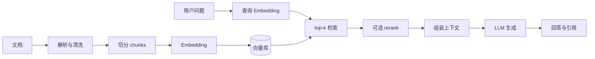
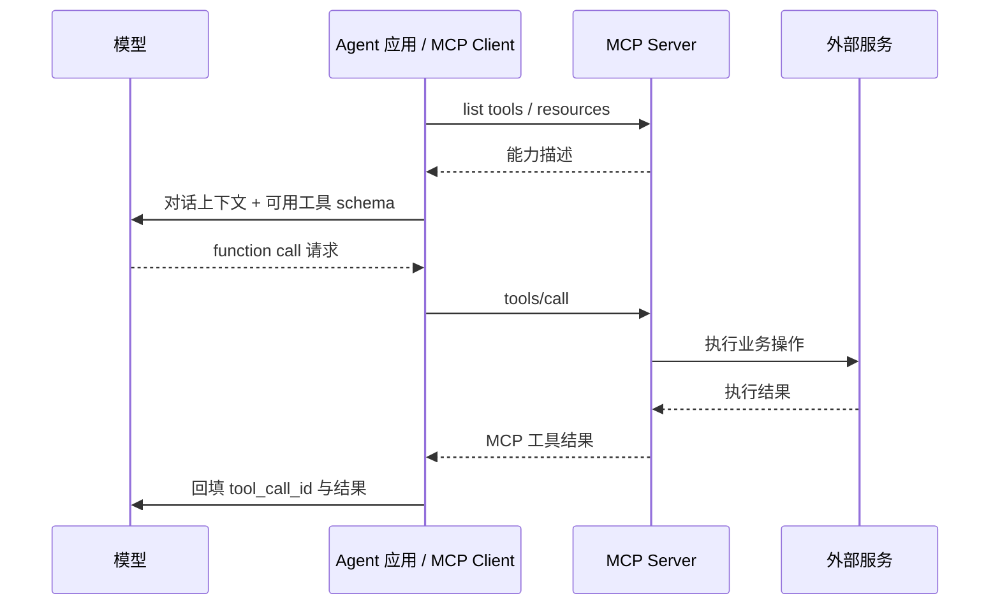

# Day 8 · RAG 全链路、检索评测与 MCP

## 学习目标

把 Day 7 的检索能力放回 RAG 流程中，能区分检索指标与答案质量；理解 MCP 如何让应用发现和调用远端工具，并说明它与模型 function calling 的分层关系。

## 1. 从文档到回答



检索结果相关不代表最终回答正确。错误可能来自解析、切分、embedding、top-k、rerank、上下文组装或生成，需要按阶段定位。

## 2. Golden set 与指标

Golden set 为每个问题标注相关 chunk ID，使检索变化能用同一组输入重复比较。

- **Recall@k** 衡量前 k 个结果找回了多少已标注的相关 chunks，适合观察漏检。
- **Hit@k** 只判断前 k 个结果中是否至少命中一个相关 chunk。
- **Precision@k** 衡量前 k 个结果中相关项占比，适合观察结果是否被无关内容占满。

Recall/Hit 评估检索，不证明最终答案忠实或正确。需要评估答案时，可加入人工标注或 LLM-as-judge；后者有调用费用、模型波动和判分标准偏差，必须保留可复查样例。

```mermaid
flowchart TD
    golden[Golden set<br/>问题与相关 chunk IDs] --> retrieve[运行固定检索器]
    retrieve --> topk[取得前 k 个 IDs]
    topk --> compare[与标注集合比较]
    compare --> recall[Recall@k]
    compare --> hit[Hit@k]
    recall --> report[生成基线报告]
    hit --> report
    report --> regression[与前次结果比较]
```

## 3. 本日代码练习

`evaluate_retrieval.py` 使用固定 golden set 和固定 top-k 结果实现 Recall@k、Hit@k 与汇总报告。它不访问数据库和模型 API，便于确定性验收。

```powershell
uv run phase2/day08/evaluate_retrieval.py
```

完成后应能解释样例的计算过程，并处理 `k <= 0`、缺失 query 结果和空相关集合等输入边界。记录指标的同时保存 golden set、检索配置和样例结果，否则数字无法复现。

## 4. MCP 与 function calling 的关系

Function calling 是模型与当前应用之间的调用约定：模型返回结构化请求，应用选择并执行本地可用的函数，再回填结果。

MCP 定义客户端与 server 之间发现和调用 tools、读取 resources、获取 prompts 的协议与传输。应用可以把 MCP server 的工具提供给模型，并将模型的 function call 映射到 MCP 请求：



因此 MCP 不替代 function calling：前者标准化应用与工具服务之间的连接，后者表达模型在一次对话中请求何种工具。请阅读 MCP 规范后写约 500 字说明这一分层，并用一个工具例子标出 client、server、模型和业务服务各自负责什么。

## 验收

- 画出 RAG 从文档 ingestion 到带引用回答的链路，并指出 top-k 与 rerank 的先后关系。
- 运行评测脚本，手算一个 query 的 Recall@k 和 Hit@k 并与输出核对。
- 用 MCP 规范中的术语解释 tools、resources、prompts 与 function calling 的职责边界。
