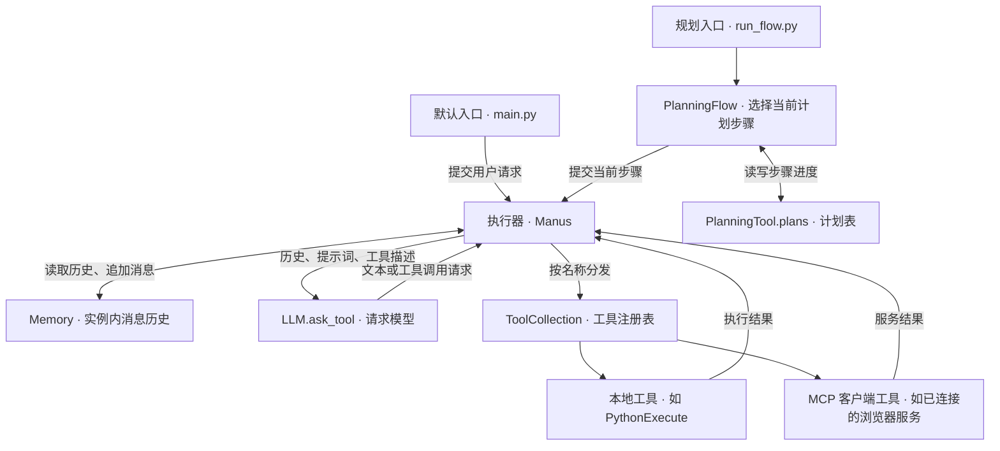

# Phase 3 · OpenManus 仓库总览

OpenManus 解决的问题是：**用户只给了目标，没有写出操作步骤，程序怎样借助模型和工具逐步完成任务？** 以「核对两笔订单，写一份交接摘要」为例：模型可以提出“查询 A，再查询 B”，但提出查询不是拿到订单。OpenManus 的工作，是把请求交给实际工具，把结果放回对话，再决定是否继续。这里的订单查询是教学示例，不是项目自带的工具。

## 架构图：先分清谁在做决定，谁真的执行

[打开独立交互架构图](assets/openmanus/openmanus.html)，可按组件查看对应源码位置。下图在 Markdown 中直接展示两条入口及工具结果的回流路径。

图中是**运行时关系，不是类继承关系**。从左侧默认入口读，不会经过规划器；只有换用规划入口才多出计划表和选步逻辑。图中也没有「模型 → 工具」的箭头：模型收到的是工具描述，持有工具对象并调用它的是本地程序。浏览器通过 MCP（模型上下文协议）接入后，对 Agent 仍表现为一个工具，但操作发生在哪里、何时结束，要看工具后端。

## 沿一笔订单走一圈

1. **目标进入历史。** [main.py](https://github.com/FoundationAgents/OpenManus/blob/99eea8e/main.py#L16-L32) 创建 `Manus` 并调用 `run(prompt)`。`run` 的循环写在父类，它把非空请求保存为 `user` 消息。到这里，程序知道目标，还没有任何订单数据。
2. **模型提出下一步。** `think()` 把消息历史、系统提示和可用工具描述交给模型。假设模型返回调用 `c1` 查 A、`c2` 查 B：此时历史中是一条含两个请求的 `assistant` 消息，而不是两份查询结果。
3. **程序执行并记录。** `act()` 按顺序等待两个调用。工具名决定取哪个对象；调用 ID 决定结果属于哪次尝试。所以同一个查询工具可以有两条不同的 `tool` 消息。下一轮模型能读到这些结果，是因为 **Agent 把它们写进历史**，不是模型自己读了订单库。
4. **循环停止不等于订单已经核对。** 终止工具可以改变 Agent 状态，耗尽步数也能让 `run` 返回。即使 `c2` 的结果是参数错误，调用仍可能留有记录。若产品承诺“已核对两笔”，验收时要检查 A、B 的实际明细；不能只数工具消息，也不能只看计划上的 `completed`。

## 为什么一个 Agent 的代码分散在四个类？

可以借用 Java 的模板方法理解：父类规定循环骨架，子类补上每一步的决策与动作。**下表是同一个 `Manus` 实例的方法分工，不是四个先后启动的服务。**

| 想弄清的问题 | 定义所在 | 阅读时抓住什么 |
|---|---|---|
| 还能不能再做一步？ | [BaseAgent.run](https://github.com/FoundationAgents/OpenManus/blob/99eea8e/app/agent/base.py#L128-L154) | 步数与状态控制 `while`；循环体调用 `self.step()`。 |
| 一步一定会执行工具吗？ | [ReActAgent.step](https://github.com/FoundationAgents/OpenManus/blob/99eea8e/app/agent/react.py#L33-L38) | 先 `think`，再决定是否 `act`。跳过本步行动不等于退出外层循环。 |
| 工具请求如何变成结果？ | [ToolCallAgent](https://github.com/FoundationAgents/OpenManus/blob/99eea8e/app/agent/toolcall.py#L131-L192) | 解析参数、按名称分发、按调用 ID 回填。 |
| 默认有哪些工具，配置放在哪里？ | [Manus](https://github.com/FoundationAgents/OpenManus/blob/99eea8e/app/agent/manus.py#L41-L99) | 组合提示词、工具集和步数上限，并在工厂方法中初始化 MCP 连接。工具目录不等于可用工具清单。 |

若关注模型供应商与消息格式，从 [app/llm.py](https://github.com/FoundationAgents/OpenManus/blob/99eea8e/app/llm.py) 读；若关注步骤如何拆分，从 [run_flow.py](https://github.com/FoundationAgents/OpenManus/blob/99eea8e/run_flow.py#L11-L35) 进入 [PlanningFlow](https://github.com/FoundationAgents/OpenManus/blob/99eea8e/app/flow/planning.py#L94-L131)。这两条问题线索不需要一起展开。

## 五天怎样接起来？

| 导读 | 读完能解释 | 源码摘抄入口 |
|---|---|---|
| [Day 09 · 入口与循环](day09/README.md) | `main` 只调用一次 `run`，为什么模型可以有多轮决策？ | [循环由谁控制](day09/01_run.md) |
| [Day 10 · 工具调用](day10/README.md) | 一个步骤里两次调用同一工具，结果如何配对？ | [按调用 ID 回填](day10/02_tool_messages.md) |
| [Day 11 · 计划与记忆](day11/README.md) | 计划表写着“核对订单”，为什么执行器还需要消息历史？ | [选步与标记完成](day11/01_plan_step.md) |
| [Day 12 · 工具与资源](day12/README.md) | 写报表时调用超时，为什么不能推断文件没写出来？ | [等进程与等输出](day12/01_timeout.md) |
| [Day 13 · 架构与验收](day13/README.md) | 哪些记录能证明程序执行过，哪些能证明任务完成？ | [达到上限后的普通返回](day13/01_run_result.md) |

五天均可离线阅读，无需启动 Agent、申请模型密钥或安装 Docker。源码链接固定到[上游提交 `99eea8e`](https://github.com/FoundationAgents/OpenManus/tree/99eea8e)，对应学习材料核对的本地 OpenManus `e4ac21a` 中的相关实现。