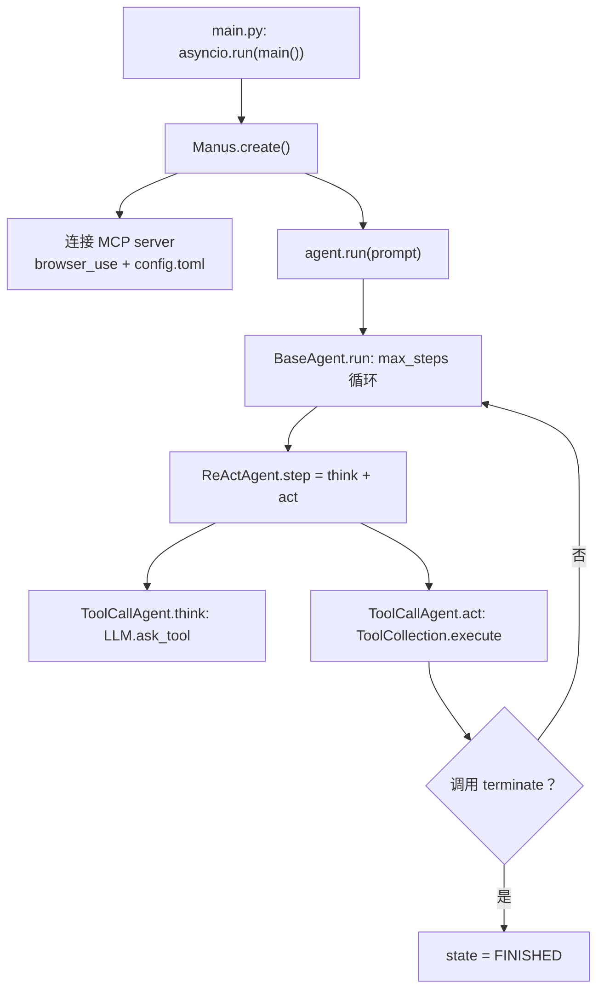

# Day 9 · OpenManus 目录地图与依赖结构

## 学习目标

从入口 `main.py` 出发，说出 OpenManus 一次运行的模块路径；能画出 app/ 的分层目录地图（agent / tool / flow / 基础设施），并指出各层只依赖哪些层。今天只读代码，不运行 OpenManus。

## 1. 问题背景：读陌生仓库从哪里下手

拿到一个不熟悉的 Python 仓库，顺序和 Java 项目相同：先看打包与入口，再看分层，最后才进单个类的实现。OpenManus 没有 `pyproject.toml`，打包信息在 `setup.py`（`python_requires=">=3.12"`，依赖列在 `install_requires`）；入口有两个：`main.py` 直接驱动单个 agent，`run_flow.py` 经 `PlanningFlow` 编排（Day 11 的内容）。

本机克隆在 `$env:USERPROFILE\repos\OpenManus`，本文与练习以 commit `3309bf4`（2026-08-16）为准。该仓库要求 Python 3.12，本机全局是 3.11.9——今天的练习只解析源码文本，不导入 OpenManus 的模块，因此不需要为它安装环境。

## 2. 入口链路：main.py 到 BaseAgent

沿这条链能核对三件事：

- `Manus.create()` 在返回前连接 MCP server（`app/agent/manus.py` 的 `initialize_mcp_servers`）：没有配置时默认拉起 `browser_use`，工具来自 MCP 的部分此后进入 `available_tools`。这是 Day 8「MCP 在 function calling 之上」的一处实例：应用把远端工具折算成本地 `BaseTool` 形状交给模型。
- 循环在 `BaseAgent.run()`：步数上限 `max_steps`（Manus 为 20）、`is_stuck()` 检查连续重复的 assistant 回复、`state_context` 保证异常时状态转成 `ERROR`。终止条件是 `FINISHED` 或步数耗尽——与 Day 5 mini loop 的轮数上限同构。
- `think`/`act` 的拆分在 `ReActAgent`：`step()` 先决定再执行。`ToolCallAgent.think` 返回「是否有工具调用要执行」，`act` 逐个执行并回填 `tool` 消息。

## 3. 分层地图：app/ 下谁依赖谁

| 层 | 位置 | 职责 | 依赖 |
|---|---|---|---|
| 入口 | `main.py`、`run_flow.py` | 解析参数、创建 agent、驱动运行 | agent、flow、config |
| agent | `app/agent/` | 状态机与 ReAct 循环：`BaseAgent` → `ReActAgent` → `ToolCallAgent` → `Manus` | tool、llm、schema、config、prompt |
| flow | `app/flow/` | 多 agent 编排：`PlanningFlow` 拆步骤再派发 | agent、tool、llm |
| tool | `app/tool/` | `BaseTool`、`ToolCollection`、三十余个具体工具 | schema、exceptions、utils |
| 基础设施 | `app/schema.py`、`app/config.py`、`app/llm.py`、`app/logger.py` | 消息/状态模型、toml 配置、API 客户端 | openai、tenacity、pydantic |

两个值得核对的依赖方向（练习 2 的输出可复核，以 commit `3309bf4` 为例）：

- **tool 层不反向依赖 agent 层——例外是演示脚本**。工具不知道 agent 的存在，`ToolCollection.execute(name, tool_input)` 只按名字分发。agent 与工具的全部耦合点是 `to_param()` 生成的 function calling schema——Day 6 练过的协议形状。唯一命中 `tool -> agent` 边的是 `tool/chart_visualization/test/` 下的两个 demo 脚本，它们不被 `app/tool/__init__` 导入，运行也不经过工具注册表；框架代码本身维持单向依赖。读仓库时，「test 目录的 import」与「库代码的 import」要分开计数，否则分层结论会被演示代码带偏。
- **schema 层被所有层依赖而不依赖任何层**。`Message`、`AgentState`、`Memory` 都在 `app/schema.py`；`Memory.add_message` 超过 `max_messages`（默认 100）时从头部截断，这是当前唯一的记忆上限机制。

Java 类比：`BaseAgent` 是模板方法模式——`run()` 固定循环骨架，`step()` 像抽象方法留给子类；Pydantic `BaseModel` 的字段声明代替了构造器参数与 getter 样板，`Field(default_factory=...)` 对应「每个实例独立的可变默认值」（不能用可变对象当默认参数，这是 Python 与 Java 默认值语义的差异点）。

## 4. 配置加载

`app/config.py` 的 `Config` 是线程安全的单例（`__new__` + 锁）。加载顺序：`config/config.toml` 存在则用它，否则回退 `config.example.toml`，用标准库 `tomllib` 解析后灌进 Pydantic 的 `AppConfig`。`[llm]` 表按名字展开成多个 `LLMSettings`（`llm`、`llm.vision`），`LLM` 类按 `config_name` 缓存单例。换模型改 toml，不改代码——这与 Java 里 profile 化的 `application.yml` 同一思路。

## 5. 边界与误区

- **地图会过期**。目录结构、类名、默认参数都随上游提交变化；引用任何「OpenManus 的行为」时标注克隆版本，复查时以 `git log -1` 的结果为准。
- **读代码不等于能运行**。未安装 3.12 环境与依赖时，`import app.agent.manus` 会直接失败；今天的验证手段是脚本解析源码与人工核对，不运行目标仓库。解析同样受版本限制：3.12 引入的 PEP 701 允许 f-string 表达式内出现反斜杠，3.11 的 `ast` 遇到这类文件会 `SyntaxError`（commit `3309bf4` 中是 `tool/chart_visualization/data_visualization.py`）。练习 2 把解析失败的文件列表打出来继续统计，边表因此可能不全；换用 3.12 环境可消除该缺口。
- **不要从名字推断行为**。`agent/mcp.py` 是 MCP 客户端接入（Agent 侧），`app/mcp/` 是 OpenManus 自己作为 server 暴露工具的模块（Server 侧），两个目录方向相反；`app/tool/sandbox/` 与 `app/sandbox/` 同理是「沙箱内的工具」与「沙箱客户端」。练习 2 的依赖边能把这种方向差异显式化。
- **`is_stuck` 的判据是内容重复**，不是步数；连续 `duplicate_threshold`（2）条相同的 assistant 回复才触发，处理方式是向 `next_step_prompt` 追加提示，不终止会话。

## 6. 本日练习

练习只读指定目录，不修改 OpenManus 仓库；两个脚本互相独立，按「学习顺序」排列而非模块依赖。

| 文件 | 关联概念 | 练习目标 | 前置练习 | 验收方式 |
|---|---|---|---|---|
| [directory_map.py](directory_map.py) | 第 3 节分层地图 | 扫描仓库目录，按子包统计 Python 文件数与行数，生成目录地图底稿 | — | `mise exec -- uv run phase3/day09/directory_map.py $env:USERPROFILE\repos\OpenManus`；内置断言验证扫描与忽略规则 |
| [import_graph.py](import_graph.py) | 第 3 节依赖方向 | 用 `ast` 解析 `from app.…` 导入，输出子包级依赖边表与解析失败清单 | directory_map.py（建议先做，共用「按子包聚合」的视角） | `mise exec -- uv run phase3/day09/import_graph.py $env:USERPROFILE\repos\OpenManus`；内置断言验证边归并；对照断言 `tool -> agent` 的边是否只来自演示脚本 |

两个脚本都需要传入目标仓库路径，默认离线、无费用。运行后把输出整理成当天的目录地图：脚本给出文件与依赖底稿，人工补三类信息——每层的职责、`BaseAgent` 到 `Manus` 的继承链、配置与入口的流向。地图是练习输出加阅读判断的合成产出，不是纯脚本转储。

## 验收

- 30 分钟内画出 app/ 的目录地图，标出 agent、tool、flow、基础设施四层及入口文件。
- 说清一次 `main.py` 运行经过的模块：`Manus.create()`（含 MCP 连接）→ `BaseAgent.run` 循环 → `think`/`act` → `ToolCollection.execute`，以及 `terminate` 如何结束循环。
- 用 `import_graph.py` 的输出核对分层表：agent 依赖哪些子包，tool 是否反向依赖 agent。
